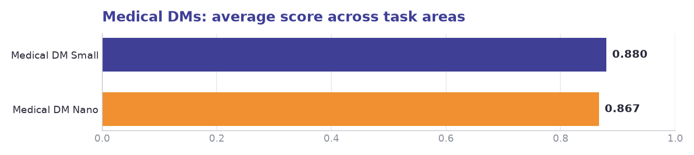
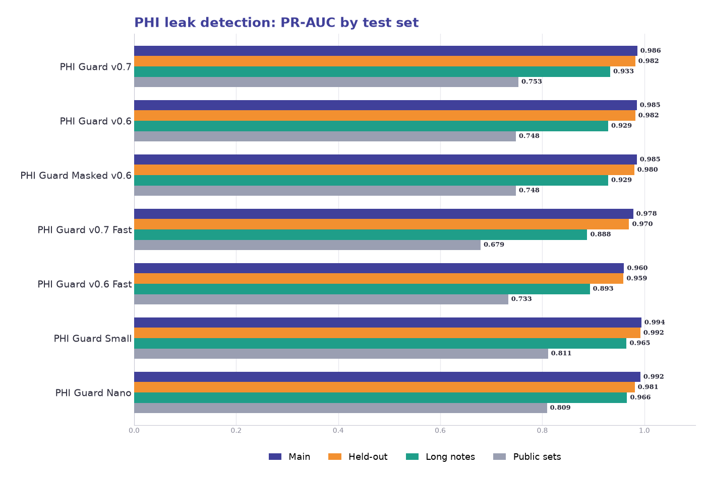
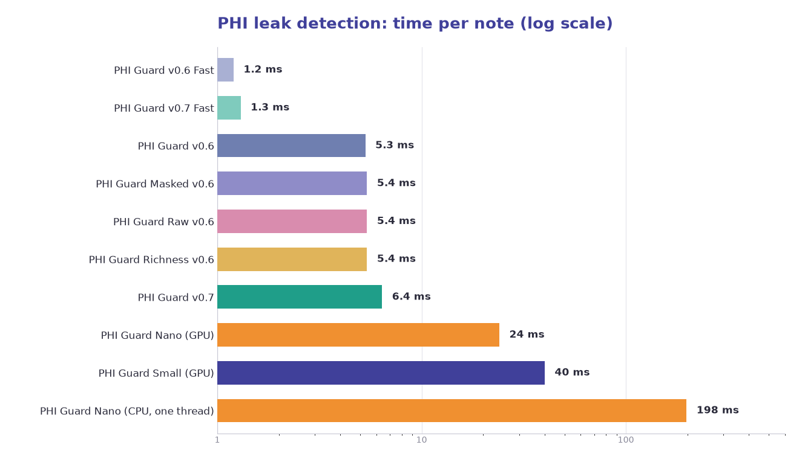
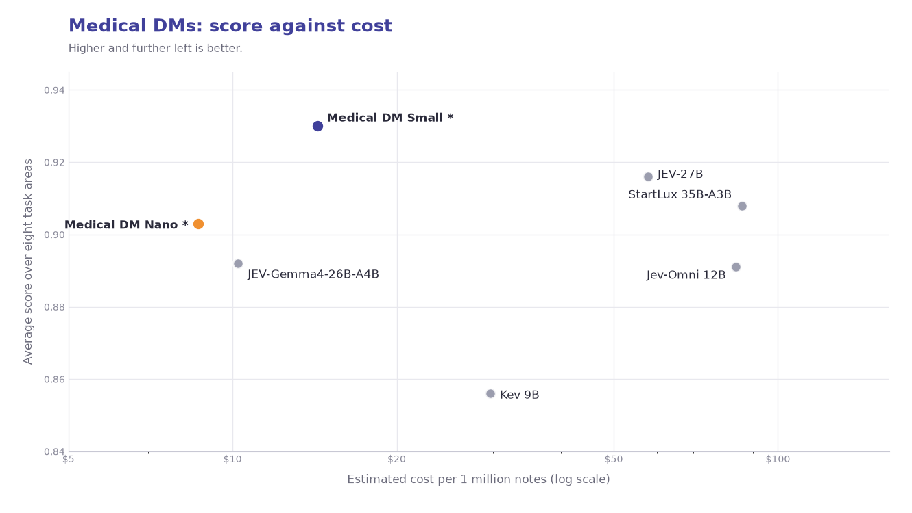

Task-optimized models consistently outperform general-purpose models on focused clinical decisions. At John Snow Labs, we have built Medical Decision Models (DMs): compact models that answer typed questions about clinical text, such as whether a note documents a condition, whether a drug caused an event, or whether a trial accepts a patient. A question can ask the model to pick one option, answer yes or no with a probability, or choose an ordered level.

Medical DMs are small enough to deploy privately, and the smallest run on a CPU. The question and its options are part of the input, so a new rule or a new threshold needs no retraining.

### Medical Decision Models (DMs) Offering

{:.table-model-big}
| Model Name | Best for | Runs on | Recommended Memory | Max Sequence Length | Supported Platforms |
|:---|:---|:---|:---|:---|:---|
| Medical DM Small | Highest average score across the nine task areas | GPU | ~16 GB GPU VRAM | 16K | On-Premise, AWS, Azure, Databricks, Snowflake |
| Medical DM Nano | Compact; runs on a single small GPU or on CPU | GPU or CPU | ~2 GB GPU VRAM | 16K | On-Premise, AWS, Azure, Databricks, Snowflake |
| PHI Guard v0.6 | Gate de-identified notes | CPU, ONNX | ~1 GB RAM | 8K | Healthcare NLP library, Models Hub |
| PHI Guard v0.6 Fast | The same gate when speed matters most | CPU, ONNX | ~1 GB RAM | 8K | Healthcare NLP library, Models Hub |
| PHI Guard Masked v0.6 | De-identified gate with a final fine-tuning step | CPU, ONNX | ~1 GB RAM | 8K | Healthcare NLP library, Models Hub |
| PHI Guard Raw v0.6 | Route or skip PHI-free raw notes | CPU, ONNX | ~1 GB RAM | 8K | Healthcare NLP library, Models Hub |
| PHI Guard Richness v0.6 | How much PHI a note exposes (levels 0 to 6) | CPU, ONNX | ~1 GB RAM | 8K | Healthcare NLP library, Models Hub |
| PHI Guard v0.7 | Leak, harm, richness and raw in one call | CPU, ONNX | ~1 GB RAM | 8K | Healthcare NLP library, Models Hub |
| PHI Guard v0.7 Fast | The same outputs, about 5x faster | CPU, ONNX | ~1 GB RAM | 8K | Healthcare NLP library, Models Hub |

Note: Recommended memory assumes half-precision (bf16) weights plus working memory at the maximum sequence length: GPU VRAM for the GPU models and RAM for the CPU models. The PHI Guard models are included in the Healthcare NLP library and run on CPU with ONNX.

<!-- TODO: link the PHI Guard models to their Models Hub pages (links from Danielo); add the tiny decision models later. -->

**Medical DM Small** is our best-scoring decision model across nine medical task areas, and **Medical DM Nano** is the compact option that runs on a single small GPU or on CPU. The **PHI Guard** family has seven CPU models that detect PHI in raw and de-identified notes, in single-purpose and all-in-one versions.

### Introduction

For PHI leak detection, PHI Guard v0.7 reaches a PR-AUC of **0.986** on de-identified clinical notes at **6.4 ms** per note on one CPU thread.

### Tasks covered

{:.table-model-big}
| Task area | What the model decides |
|:---|:---|
| Cancer registry abstraction | Registry fields from a pathology report: organ, tumor type, grade, TNM categories, stage, margins, lymphovascular invasion, receptors. A field the report never states is returned as not stated. |
| Coding and prior authorization | Whether a diagnosis or a prior-authorization request is supported under a rule written into the question. |
| Cohort identification | Whether a patient has each condition on a list: present, possible, absent or not documented. |
| Adverse drug events | For one drug and one event: onset, severity, attribution, action taken, and the outcome of stopping and restarting the drug. |
| General clinical decisions | A set of clinical decision tasks: evidence sufficiency, reconciliation, temporal relevance, reliability, attribution, escalation, causality, trajectory and more. |
| Quality measure review | Evidence questions on patient charts for adult care-quality measures: eligibility, exclusions, time windows, medicines and tests. |
| Clinical note review | Chart review of a clinical note: note type, age group, tobacco use, allergies, diabetes, kidney function, anticoagulation, cancer status. |
| Clinical trial eligibility | Demographic gate, inclusion or exclusion, specialty, numeric thresholds and time windows. |
| Oncology record review | Whether a document in an oncology record is relevant to a registry abstract, whether it adds anything new, and which fields it states. |
| PHI leak detection | Whether a de-identified note still leaks protected health information (PHI), whether a raw note holds any, how much a note exposes, and whether a leak is harmful. |

### Task Benchmark Performance

Score on nine task areas: the mean of accuracy and macro precision, recall and F1. Bold is the best score in the row.

{:.table-model-big}
| Task area | Medical DM Nano | Medical DM Small |
|:---|---:|---:|
| Cancer registry abstraction | **0.961** | 0.885 |
| Coding and prior authorization | 0.888 | **0.930** |
| Cohort identification | 0.950 | **0.958** |
| Adverse drug events | **0.972** | 0.914 |
| General clinical decisions | 0.860 | **0.963** |
| Oncology record review | **0.885** | 0.818 |
| Quality measure review | 0.875 | **0.902** |
| Clinical note review | 0.935 | **0.955** |
| Clinical trial eligibility | 0.781 | **0.931** |
| **Average** | 0.901 | **0.917** |

**Medical DM Small is ahead on six of nine task areas, with its largest margin on clinical trial eligibility (0.931 against 0.781). Medical DM Nano is ahead on cancer registry abstraction, adverse drug events and oncology record review.**

### PHI Guard Models and Modes

The PHI Guard family has seven models. Each answers one or more questions about a note: does a de-identified note still leak PHI, does a raw note hold any PHI, how much PHI does a note expose, and is a leak harmful.

{:.table-model-big}
| Model | Outputs | Use on | What it does | Example |
|:---|:---|:---|:---|:---|
| PHI Guard v0.6 | 1: a score, the probability that PHI is still readable | De-identified text | Gate de-identified notes before they leave the pipeline. | "Pt Maria Delgado seen on [DATE]..." scores 0.99 (leak); "Pt [NAME] seen on [DATE]..." scores 0.02 |
| PHI Guard v0.6 Fast | 1: a score | De-identified text | The same gate when speed matters more than precision. It flags many more clean notes. |  |
| PHI Guard Masked v0.6 | 1: a score | De-identified text | The v0.6 gate with a final fine-tuning step. It scores almost the same as PHI Guard v0.6. |  |
| PHI Guard Raw v0.6 | 1: a score, the probability that a raw note holds any PHI | Raw text | Skip or route PHI-free notes before de-identification. | "Shortness of breath, lungs clear, continue inhaler." scores 0.01; "John Miller, 64, seen 2024-02-11..." scores 0.99 |
| PHI Guard Richness v0.6 | 6: the probability that the level is at least 1, 2, up to 6; the level is how many reach 0.5 | Raw or de-identified text | How much PHI a note exposes, from level 0 (none) to level 6 (saturated). | A discharge note with a name, date of birth, MRN and phone number gets level 5 |
| PHI Guard v0.7 | 9: leak, harmful, richness (at least 1 to 6) and raw | Both, depending on the output | One call for everything. | "Patient [NAME], DOB 03/14/1956, MRN 4471923..." gets leak 0.99, harmful 0.99, level 3, raw 0.10 |
| PHI Guard v0.7 Fast | The same 9 outputs | Both, depending on the output | The same outputs, about 5x faster and a little less exact. |  |

PHI Guard v0.7 folds the leak, raw and richness models and a new harmful output into one model, with no loss of accuracy on any of them.

### PHI Leak Detection

Does a de-identified note still leak PHI? PR-AUC with a leak as the positive class. Public sets are the mean of four public datasets. The last column counts clean notes wrongly flagged at the 0.5 cut-off on the main set; fewer is better. Bold is the best in each column.

{:.table-model-big}
| Model | Main | Held-out | Long notes | Public sets | Clean notes flagged, main |
|:---|---:|---:|---:|---:|---:|
| PHI Guard v0.7 | **0.986** | 0.982 | 0.933 | **0.753** | 91 |
| PHI Guard v0.6 | 0.985 | 0.982 | 0.929 | 0.748 | 91 |
| PHI Guard Masked v0.6 | 0.985 | 0.980 | 0.929 | 0.748 | 96 |
| PHI Guard v0.7 Fast | 0.978 | 0.970 | 0.888 | 0.679 | 113 |
| PHI Guard v0.6 Fast | 0.960 | 0.959 | 0.893 | 0.733 | 384 |
| Medical DM Small | 0.986 | **0.986** | **0.955** | 0.752 | **39** |

**PHI Guard v0.7 matches or slightly beats PHI Guard v0.6 on every set. PHI Guard v0.7 Fast has far fewer false alarms than PHI Guard v0.6 Fast on the main set (113 against 384), but it is weaker on the public sets (0.679 against 0.733).**

#### Harmful leaks

Harmful PR-AUC, and the share of harmless-only leaks wrongly flagged at 0.5 on the main set; lower is better. The v0.6 models have no harm output, so the v0.6 leak score stands in.

{:.table-model-big}
| Model | Main | Held-out | Long notes | Harmless-only leaks flagged, main |
|:---|---:|---:|---:|---:|
| PHI Guard v0.6 (leak score) | 0.962 | 0.779 | 0.904 | 70% |
| PHI Guard v0.7 | **0.980** | 0.883 | 0.928 | 38% |
| PHI Guard v0.7 Fast | 0.977 | **0.885** | **0.936** | **21%** |

#### Raw notes

Does a raw note contain any PHI? PR-AUC on the test split and on held-out notes, and the notes wrongly flagged or missed at 0.5 on the test split.

{:.table-model-big}
| Model | Test PR-AUC | False positives | False negatives | Held-out PR-AUC |
|:---|---:|---:|---:|---:|
| PHI Guard Raw v0.6 | **0.9993** | 29 | **38** | 0.9984 |
| PHI Guard v0.7 | 0.9992 | **28** | 42 | **0.9986** |
| PHI Guard v0.7 Fast | **0.9993** | 47 | 42 | 0.9973 |

#### Richness

How much PHI a note exposes. Level error (MAE, lower is better) and rank correlation (rho, higher is better) on masked notes; the last two columns are held-out raw notes.

{:.table-model-big}
| Model | Main MAE | Main rho | Held-out MAE | Held-out rho | Long MAE | Long rho | Raw MAE | Raw rho |
|:---|---:|---:|---:|---:|---:|---:|---:|---:|
| PHI Guard Richness v0.6 | **0.137** | 0.859 | 0.325 | 0.902 | 0.245 | **0.773** | 0.265 | 0.954 |
| PHI Guard v0.7 | 0.140 | **0.866** | **0.303** | **0.909** | **0.238** | 0.755 | **0.238** | **0.956** |
| PHI Guard v0.7 Fast | 0.162 | 0.850 | 0.372 | 0.894 | 0.271 | 0.715 | 0.301 | 0.949 |

#### Speed per note

CPU models: one thread, a 1 KB note. GPU model: batched on a 24 GB GPU.

{:.table-model-big}
| Model | Runs on | Per note (ms) | One million notes |
|:---|:---|---:|---:|
| PHI Guard v0.6 | CPU, one thread (ONNX) | 5.3 | 1.5 h |
| PHI Guard v0.6 Fast | CPU, one thread (ONNX) | 1.2 | 20 min |
| PHI Guard Masked v0.6 | CPU, one thread (ONNX) | 5.4 | 1.5 h |
| PHI Guard Raw v0.6 | CPU, one thread (ONNX) | 5.4 | 1.5 h |
| PHI Guard Richness v0.6 | CPU, one thread (ONNX) | 5.4 | 1.5 h |
| PHI Guard v0.7 | CPU, one thread (ONNX) | 6.4 | 1.8 h |
| PHI Guard v0.7 Fast | CPU, one thread (ONNX) | 1.3 | 21.7 min |
| Medical DM Small | GPU (24 GB) | 40 | ~10-12 h |

### Cost Analysis
In addition to processing speed, infrastructure cost is an important consideration when evaluating the operational scalability of Medical Decision Models.

Based on our benchmark measurements, Medical DM Small processes approximately 40 ms per note, corresponding to an estimated 10–12 hours to process 1 million clinical notes on a GPU with 24 GB memory. Medical DM Nano processes approximately 24 ms per note, corresponding to an estimated 6–7 hours.

#### Estimated Infrastructure Cost

{:.table-model-big}
| Metric | Medical DM Nano | Medical DM Small |
|:---|---:|---:|
| Hardware | GPU (24GB) | GPU (24GB) |
| Processing time per note | 24 ms | 40 ms |
| Runtime per 1 million notes | ~6 - 7 hours | ~10 - 12 hours |
| Assumed GPU cost per hour | $1.30 | $1.30 |
| Estimated cost per 1 million notes | $7.85 - $9.42 | $13.00 - $15.60 |

For cost estimation, we assume an illustrative GPU rental rate of $1.30 per hour.

#### Comparison with Other Decision Models

Medical DM Small is the reference: 40 ms per note, about 11 hours per 1 million notes. Every other model was measured on the same set of notes, on the smallest GPU it fits on, and is shown at the same scale, so the ratios between models are the measured ratios. The score is the average over eight task areas from the benchmark above.

{:.table-model-big}
| Model              | GPU used (price per hour) | Average score | Time per 1 million notes | Cost per 1 million notes |
| :----------------- | :------------------------ | ------------: | -----------------------: | -----------------------: |
| Medical DM Nano *  | A10 24 GB ($1.30)         | 0.903         | ~6.6 hours               | ~$8.60                   |
| JEV-Gemma4-26B-A4B | H100 80 GB ($4.20)        | 0.892         | ~2.4 hours               | ~$10.20                  |
| Medical DM Small * | A10 24 GB ($1.30)         | 0.930         | ~11 hours                | ~$14.30                  |
| Kev 9B             | A10 24 GB ($1.30)         | 0.856         | ~23 hours                | ~$29.70                  |
| JEV-27B            | H100 80 GB ($4.20)        | 0.916         | ~14 hours                | ~$57.80                  |
| Jev-Omni 12B       | A100 40 GB ($1.99)        | 0.891         | ~42 hours                | ~$83.70                  |
| StartLux 35B-A3B   | H100 80 GB ($4.20)        | 0.908         | ~20 hours                | ~$85.80                  |

**Medical DM Nano and Medical DM Small run on a 24 GB GPU that costs $1.30 per hour. The models closest to Medical DM Small in score, JEV-27B and StartLux 35B-A3B, need an 80 GB H100 at $4.20 per hour and cost about 4 and 6 times as much per million notes ($57.80 and $85.80 against $14.30).**

#### Score and Cost

Medical DM Small has the highest score of the models compared, and Medical DM Nano has the lowest cost. No other model beats either of them on both score and cost.

Note: The GPU hourly rates of $1.30 (A10, 24 GB), $1.99 (A100, 40 GB) and $4.20 (H100, 80 GB) are illustrative pricing assumptions and are not official John Snow Labs prices. Runtime and cost estimates are based on the benchmark configuration described above.

#### Calculation Methodology
Estimated compute  cost is calculated using

**Estimated Cost = Runtime (hours) × GPU hourly rate**

These estimates represent GPU compute costs only and exclude storage, networking, orchestration, and other infrastructure expenses. Actual costs will vary depending on the GPU instance, cloud provider, and deployment configuration.

**Note:** The GPU hourly rate of $1.30 is an illustrative pricing assumption and is not an official John Snow Labs price. Runtime and cost estimates are based on the benchmark configuration described above.

