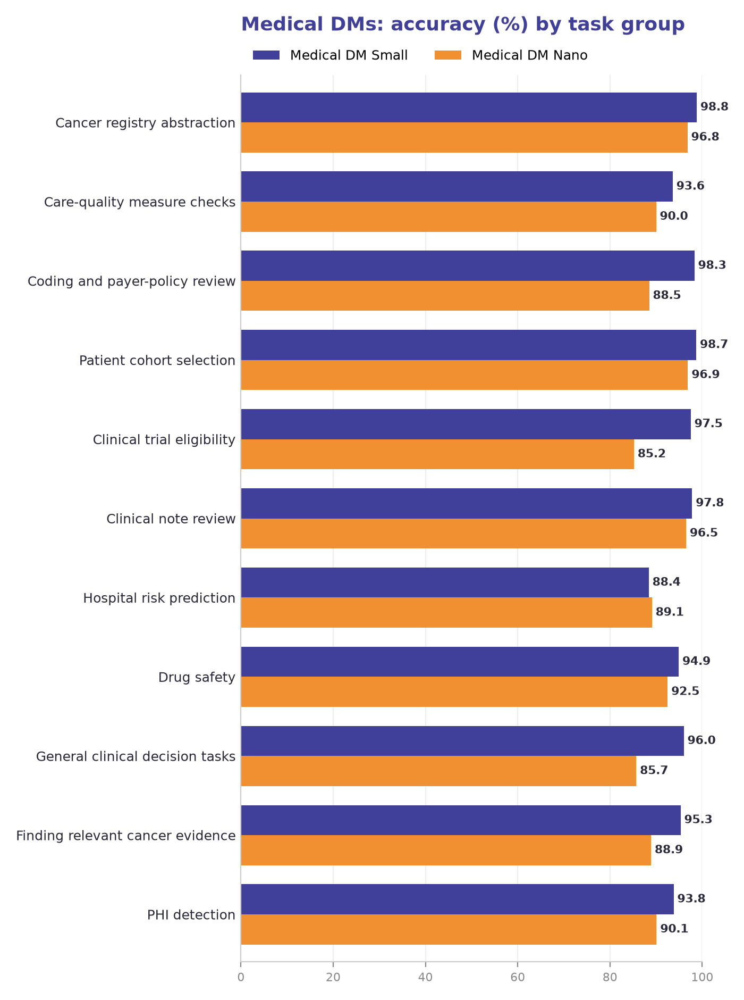
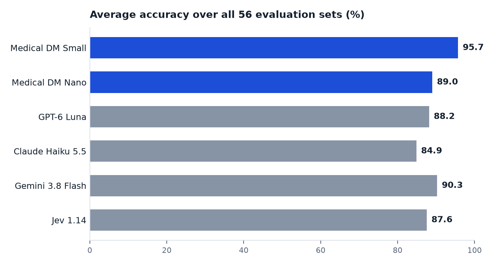
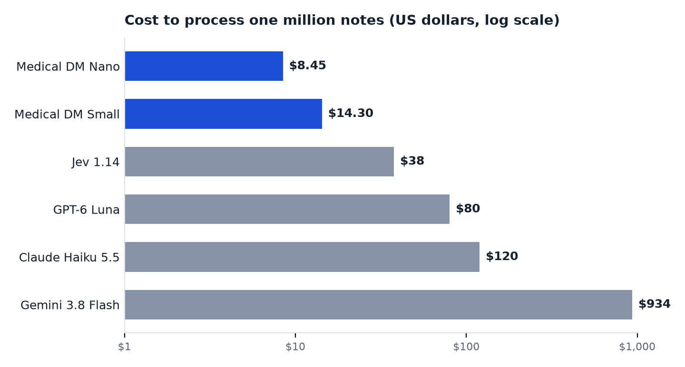
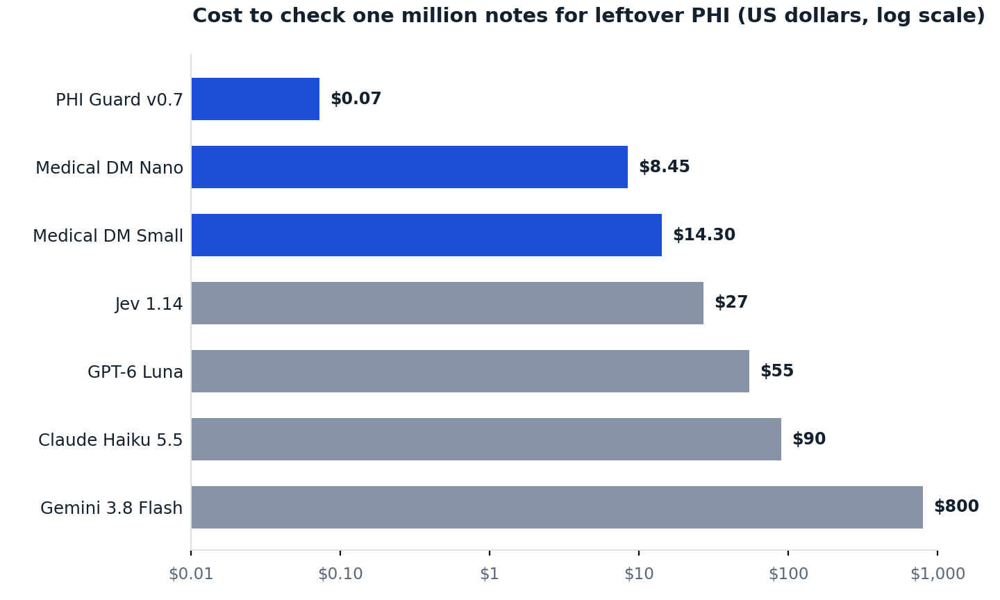

Task-optimized models consistently outperform general-purpose models on focused clinical decisions. At John Snow Labs, we have built Medical Decision Models (DMs): compact models that answer typed questions about clinical text, such as whether a note documents a condition, whether a drug caused an event, or whether a trial accepts a patient. A question can ask the model to pick one option, answer yes or no with a probability, or choose an ordered level.

Medical DMs are small enough to deploy privately, and the smallest run on a CPU. The question and its options are part of the input, so a new rule or a new threshold needs no retraining.

### Medical Decision Models (DMs) Offering

{:.table-model-big}
| Model Name | Best for | Runs on | Recommended Memory | Max Sequence Length | Supported Platforms |
|:---|:---|:---|:---|:---|:---|
| Medical DM Small | Highest average accuracy across the eleven task groups | GPU | ~16 GB GPU VRAM | 16K | On-Premise, AWS, Azure, Databricks, Snowflake |
| Medical DM Nano | Compact; runs on a single small GPU or on CPU | GPU or CPU | ~2 GB GPU VRAM | 8K | On-Premise, AWS, Azure, Databricks, Snowflake |
| PHI Guard v0.6 | Gate de-identified notes | CPU, ONNX | ~1 GB RAM | 8K | Healthcare NLP library, Models Hub |
| PHI Guard v0.6 Fast | The same gate when speed matters most | CPU, ONNX | ~1 GB RAM | 8K | Healthcare NLP library, Models Hub |
| PHI Guard Masked v0.6 | De-identified gate with a final fine-tuning step | CPU, ONNX | ~1 GB RAM | 8K | Healthcare NLP library, Models Hub |
| PHI Guard Raw v0.6 | Route or skip PHI-free raw notes | CPU, ONNX | ~1 GB RAM | 8K | Healthcare NLP library, Models Hub |
| PHI Guard Richness v0.6 | How much PHI a note exposes (levels 0 to 6) | CPU, ONNX | ~1 GB RAM | 8K | Healthcare NLP library, Models Hub |
| PHI Guard v0.7 | Leak, harm, richness and raw in one call | CPU, ONNX | ~1 GB RAM | 8K | Healthcare NLP library, Models Hub |
| PHI Guard v0.7 Fast | The same outputs, about 5x faster | CPU, ONNX | ~1 GB RAM | 8K | Healthcare NLP library, Models Hub |
| PHI Guard Small | Highest accuracy PHI gate: leak, harm, richness and raw | GPU | ~16 GB GPU VRAM | 16K | On-Premise, AWS, Azure, Databricks, Snowflake |
| PHI Guard Nano | Compact PHI gate; runs on a small GPU or on CPU | GPU or CPU | ~2 GB GPU VRAM | 8K | On-Premise, AWS, Azure, Databricks, Snowflake |

Note: Recommended memory assumes half-precision (bf16) weights plus working memory at the maximum sequence length: GPU VRAM for the GPU models and RAM for the CPU models. The seven ONNX PHI Guard models (v0.6 and v0.7) are included in the Healthcare NLP library and run on CPU. PHI Guard Small and PHI Guard Nano are deployed like the Medical DMs.

<!-- TODO: link the PHI Guard models to their Models Hub pages (links from Danielo); add the tiny decision models later. -->

**Medical DM Small** is our highest-accuracy decision model, on average across eleven medical task groups, and **Medical DM Nano** is the compact option that runs on a single small GPU or on CPU. The **PHI Guard** family has nine models that detect PHI in raw and de-identified notes, in single-purpose and all-in-one versions: seven CPU models, and **PHI Guard Small** and **PHI Guard Nano**, which run on a GPU (Nano also on CPU).

### Introduction

For PHI leak detection, PHI Guard v0.7 reaches a PR-AUC of **0.986** on de-identified clinical notes at **6.4 ms** per note on one CPU thread.

### Tasks covered

{:.table-model-big}
| Task group | What the model decides |
|:---|:---|
| Cancer registry abstraction | Registry fields from a pathology report: organ, tumor type, grade, TNM categories, stage, margins, lymphovascular invasion, receptors. A field the report never states is returned as not stated. |
| Care-quality measure checks | Evidence questions on patient charts for adult care-quality measures: eligibility, exclusions, time windows, medicines and tests. |
| Coding and payer-policy review | Whether a diagnosis or a prior-authorization request is supported under a rule written into the question. |
| Patient cohort selection | Whether a patient has each condition on a list: present, possible, absent or not documented. |
| Clinical trial eligibility | Demographic gate, inclusion or exclusion, specialty, numeric thresholds and time windows. |
| Clinical note review | Chart review of a clinical note: note type, age group, tobacco use, allergies, diabetes, kidney function, anticoagulation, cancer status. |
| Hospital risk prediction | Readmission and ICU outcome questions. |
| Drug safety | For one drug and one event: onset, severity, attribution, action taken, and the outcome of stopping and restarting the drug. |
| General clinical decision tasks | A set of clinical decision tasks: evidence sufficiency, reconciliation, temporal relevance, reliability, attribution, escalation, causality, trajectory and more. |
| Finding relevant cancer evidence | Whether a document or passage in an oncology record is relevant to a registry abstract, whether it adds anything new, and which fields it states. |
| PHI detection | Whether a de-identified note still leaks protected health information (PHI), whether a raw note holds any, how much a note exposes, and whether a leak is harmful. |

### Task Benchmark Performance

We ran Medical DM Small and Medical DM Nano against the cheapest frontier API models on the market, GPT-6 Luna, Claude Haiku 5.5 and Gemini 3.8 Flash, plus Jev 1.14. Every model answered the same questions about the same documents: 56 evaluation sets in 11 task groups, with 9,526 documents and 14,587 questions in total.

- **95.7%**: Medical DM Small, average accuracy over the 56 sets. The best API model scores 90.3%.
- **89.0%**: Medical DM Nano, average accuracy over the 56 sets. The API models range from 84.9% to 90.3%.

#### How we tested

{:.table-model-big}
| | |
|:---|:---|
| Datasets | 56, in 11 task groups |
| Documents | 9,526 |
| Questions | 14,587 |
| Question types | Yes or no 6,677 (46%), pick one option 6,195 (42%), score 1,715 (12%) |
| Document length | 1,296 words on average |
| Size of one request | about 1,400 words on average, including the question text and options |

A decision model answers typed questions about a document. The three question types are:

- Yes or no: the model decides whether the statement is true for the document.
- Pick one option: the model chooses one label from a short list. Every label is defined in the question.
- Score: the model chooses a level from an ordered list, for example unlikely, possible, probable or certain.

How each model was run:

- Each API model received the document and all of its questions in one request, with the options spelled out, and replied with the chosen option only. Temperature was 0. GPT-6 Luna and Claude Haiku 5.5 ran with reasoning off. Gemini 3.8 Flash always reasons, so it ran at low effort.
- The Medical DM models read the same document and question and score every option directly. Yes or no questions use a 0.5 cut-off, and other questions take the highest-scoring option.
- Accuracy is the share of questions answered correctly in each dataset, averaged within each task group. The Overall row is the average over all 56 datasets.

#### Accuracy

John Snow Labs models are blue, API models are grey.

Accuracy (%) by task group. Bold is the best score in the row. The first two columns are John Snow Labs models (*).

{:.table-model-big}
| Task group | Medical DM Small * | Medical DM Nano * | GPT-6 Luna | Claude Haiku 5.5 | Gemini 3.8 Flash | Jev 1.14 |
|:---|---:|---:|---:|---:|---:|---:|
| Cancer registry abstraction | **98.8** | 96.8 | 94.3 | 91.3 | 95.3 | 89.9 |
| Care-quality measure checks | 93.6 | 90.0 | 83.4 | 74.5 | **98.1** | 83.6 |
| Coding and payer-policy review | **98.3** | 88.5 | 96.3 | 89.4 | 97.6 | 92.9 |
| Patient cohort selection | 98.7 | 96.9 | **99.1** | 97.0 | **99.1** | 98.0 |
| Clinical trial eligibility | **97.5** | 85.2 | 94.2 | 92.8 | 95.2 | 94.7 |
| Clinical note review | **97.8** | 96.5 | 96.4 | 93.7 | 96.9 | 94.4 |
| Hospital risk prediction | 88.4 | **89.1** | 85.6 | 88.1 | 88.6 | 87.4 |
| Drug safety | 94.9 | 92.5 | 94.6 | 88.3 | **95.7** | 92.8 |
| General clinical decision tasks | **96.0** | 85.7 | 88.8 | 87.1 | 87.5 | 89.3 |
| Finding relevant cancer evidence | **95.3** | 88.9 | 85.3 | 83.3 | 88.6 | 82.6 |
| PHI detection | **93.8** | 90.1 | 72.4 | 59.3 | 87.1 | 74.7 |
| Overall (56 sets) | **95.7** | 89.0 | 88.2 | 84.9 | 90.3 | 87.6 |

Medical DM Small has the highest score in 7 of the 11 task groups. Gemini 3.8 Flash is highest, or tied for highest, in three and Medical DM Nano in one. Gemini 3.8 Flash is the strongest API model and leads on care-quality measure checks and drug safety, and shares the top score on patient cohort selection. It is also the most expensive, as the Cost Analysis below shows.

### PHI Guard Models and Modes

The PHI Guard family has nine models. Each answers one or more questions about a note: does a de-identified note still leak PHI, does a raw note hold any PHI, how much PHI does a note expose, and is a leak harmful.

{:.table-model-big}
| Model | Outputs | Use on | What it does | Example |
|:---|:---|:---|:---|:---|
| PHI Guard v0.6 | 1: a score, the probability that PHI is still readable | De-identified text | Gate de-identified notes before they leave the pipeline. | "Pt Maria Delgado seen on [DATE]..." scores 0.99 (leak); "Pt [NAME] seen on [DATE]..." scores 0.02 |
| PHI Guard v0.6 Fast | 1: a score | De-identified text | The same gate when speed matters more than precision. It flags many more clean notes. |  |
| PHI Guard Masked v0.6 | 1: a score | De-identified text | The v0.6 gate with a final fine-tuning step. It scores almost the same as PHI Guard v0.6. |  |
| PHI Guard Raw v0.6 | 1: a score, the probability that a raw note holds any PHI | Raw text | Skip or route PHI-free notes before de-identification. | "Shortness of breath, lungs clear, continue inhaler." scores 0.01; "John Miller, 64, seen 2024-02-11..." scores 0.99 |
| PHI Guard Richness v0.6 | 6: the probability that the level is at least 1, 2, up to 6; the level is how many reach 0.5 | Raw or de-identified text | How much PHI a note exposes, from level 0 (none) to level 6 (saturated). | A discharge note with a name, date of birth, MRN and phone number gets level 5 |
| PHI Guard v0.7 | 9: leak, harmful, richness (at least 1 to 6) and raw | Both, depending on the output | One call for everything. | "Patient [NAME], DOB 03/14/1956, MRN 4471923..." gets leak 0.99, harmful 0.99, level 3, raw 0.10 |
| PHI Guard v0.7 Fast | The same 9 outputs | Both, depending on the output | The same outputs, about 5x faster and a little less exact. |  |
| PHI Guard Small | 9: leak, harmful, richness (at least 1 to 6) and raw, from four questions | Both, depending on the output | The most accurate PHI gate. One model for leak, harm, richness and raw. |  |
| PHI Guard Nano | The same 9 outputs | Both, depending on the output | The compact version of PHI Guard Small. Also trained on noisy (OCR-style) text. |  |

PHI Guard v0.7 folds the leak, raw and richness models and a new harmful output into one model, with no loss of accuracy on any of them.

### PHI Leak Detection

Does a de-identified note still leak PHI? PR-AUC with a leak as the positive class. Public sets are the mean of four public datasets. The last column counts clean notes wrongly flagged at the 0.5 cut-off on the main set; fewer is better. Bold is the best in each column.

{:.table-model-big}
| Model | Main | Held-out | Long notes | Public sets | Clean notes flagged, main |
|:---|---:|---:|---:|---:|---:|
| PHI Guard v0.7 | 0.986 | 0.982 | 0.933 | 0.753 | 91 |
| PHI Guard v0.6 | 0.985 | 0.982 | 0.929 | 0.748 | 91 |
| PHI Guard Masked v0.6 | 0.985 | 0.980 | 0.929 | 0.748 | 96 |
| PHI Guard v0.7 Fast | 0.978 | 0.970 | 0.888 | 0.679 | 113 |
| PHI Guard v0.6 Fast | 0.960 | 0.959 | 0.893 | 0.733 | 384 |
| PHI Guard Small | **0.994** | **0.992** | 0.965 | **0.811** | **26** |
| PHI Guard Nano | 0.992 | 0.981 | **0.966** | 0.809 | 41 |

**PHI Guard v0.7 matches or slightly beats PHI Guard v0.6 on every set. PHI Guard v0.7 Fast has far fewer false alarms than PHI Guard v0.6 Fast on the main set (113 against 384), but it is weaker on the public sets (0.679 against 0.733).**

#### Harmful leaks

Harmful PR-AUC, and the share of harmless-only leaks wrongly flagged at 0.5 on the main set; lower is better. The v0.6 models have no harm output, so the v0.6 leak score stands in.

{:.table-model-big}
| Model | Main | Held-out | Long notes | Harmless-only leaks flagged, main |
|:---|---:|---:|---:|---:|
| PHI Guard v0.6 (leak score) | 0.962 | 0.779 | 0.904 | 70% |
| PHI Guard v0.7 | **0.980** | 0.883 | 0.928 | 38% |
| PHI Guard v0.7 Fast | 0.977 | 0.885 | **0.936** | 21% |
| PHI Guard Small | 0.977 | **0.892** | 0.855 | 3.9% |
| PHI Guard Nano | 0.970 | 0.880 | 0.883 | **0.5%** |

#### Raw notes

Does a raw note contain any PHI? PR-AUC on the test split and on held-out notes, and the notes wrongly flagged or missed at 0.5 on the test split.

{:.table-model-big}
| Model | Test PR-AUC | False positives | False negatives | Held-out PR-AUC |
|:---|---:|---:|---:|---:|
| PHI Guard Raw v0.6 | 0.9993 | 29 | 38 | 0.9984 |
| PHI Guard v0.7 | 0.9992 | 28 | 42 | 0.9986 |
| PHI Guard v0.7 Fast | 0.9993 | 47 | 42 | 0.9973 |
| PHI Guard Small | **0.9997** | **15** | 39 | **0.9998** |
| PHI Guard Nano | **0.9997** | 21 | **17** | 0.9996 |

#### Richness

How much PHI a note exposes. Level error (MAE, lower is better) and rank correlation (rho, higher is better) on masked notes; the last two columns are held-out raw notes.

{:.table-model-big}
| Model | Main MAE | Main rho | Held-out MAE | Held-out rho | Long MAE | Long rho | Raw MAE | Raw rho |
|:---|---:|---:|---:|---:|---:|---:|---:|---:|
| PHI Guard Richness v0.6 | 0.137 | 0.859 | 0.325 | 0.902 | 0.245 | 0.773 | 0.265 | 0.954 |
| PHI Guard v0.7 | 0.140 | 0.866 | 0.303 | 0.909 | 0.238 | 0.755 | 0.238 | 0.956 |
| PHI Guard v0.7 Fast | 0.162 | 0.850 | 0.372 | 0.894 | 0.271 | 0.715 | 0.301 | 0.949 |
| PHI Guard Small | **0.084** | **0.887** | **0.130** | **0.952** | **0.141** | **0.826** | 0.146 | **0.965** |
| PHI Guard Nano | 0.097 | 0.871 | 0.161 | 0.942 | 0.158 | 0.792 | **0.117** | 0.964 |

#### Speed per note

CPU models: one thread, a 1 KB note. GPU models: batched on a 24 GB GPU.

{:.table-model-big}
| Model | Runs on | Per note (ms) | One million notes |
|:---|:---|---:|---:|
| PHI Guard v0.6 | CPU, one thread (ONNX) | 5.3 | 1.5 h |
| PHI Guard v0.6 Fast | CPU, one thread (ONNX) | 1.2 | 20 min |
| PHI Guard Masked v0.6 | CPU, one thread (ONNX) | 5.4 | 1.5 h |
| PHI Guard Raw v0.6 | CPU, one thread (ONNX) | 5.4 | 1.5 h |
| PHI Guard Richness v0.6 | CPU, one thread (ONNX) | 5.4 | 1.5 h |
| PHI Guard v0.7 | CPU, one thread (ONNX) | 6.4 | 1.8 h |
| PHI Guard v0.7 Fast | CPU, one thread (ONNX) | 1.3 | 21.7 min |
| PHI Guard Small | GPU (24 GB) | 40 | ~10-12 h |
| PHI Guard Nano | CPU (16 cores) | 198 | 56 h |
| PHI Guard Nano | GPU (24 GB) | 24 | 6.7 h |

### Cost Analysis
In addition to processing speed, infrastructure cost is an important consideration when evaluating the operational scalability of Medical Decision Models.

Based on our benchmark measurements, Medical DM Small processes approximately 40 ms per note, corresponding to an estimated 10–12 hours to process 1 million clinical notes on a GPU with 24 GB memory. Medical DM Nano processes approximately 24 ms per note, corresponding to an estimated 6–7 hours.

#### Estimated Infrastructure Cost

{:.table-model-big}
| Metric | Medical DM Nano | Medical DM Small |
|:---|---:|---:|
| Hardware | GPU (24GB) | GPU (24GB) |
| Processing time per note | 24 ms | 40 ms |
| Runtime per 1 million notes | ~6 - 7 hours | ~10 - 12 hours |
| Assumed GPU cost per hour | $1.30 | $1.30 |
| Estimated cost per 1 million notes | $7.80 - $9.10 | $13.00 - $15.60 |

For cost estimation, we assume an illustrative GPU rental rate of $1.30 per hour.

#### Comparison with Other Decision Models

Medical DM Small is the reference: 40 ms per note, about 11 hours per 1 million notes. Every other model was measured on the same set of notes, on the smallest GPU it fits on, and is shown at the same scale, so the ratios between models are the measured ratios. The accuracy is the average over the evaluation sets from the benchmark above.

{:.table-model-big}
| Model | GPU used (price per hour) | Average accuracy (%) | Time per 1 million notes | Cost per 1 million notes |
| :--- | :--- | ---: | ---: | ---: |
| Medical DM Nano * | A10 24 GB ($1.30) | 89.0 | ~6.5 hours | ~$8.45 |
| JEV-Gemma4-26B-A4B | H100 80 GB ($4.20) | 87.9 | ~2.4 hours | ~$10.20 |
| Medical DM Small * | A10 24 GB ($1.30) | 95.7 | ~11 hours | ~$14.30 |
| Kev 9B | A10 24 GB ($1.30) | 85.8 | ~23 hours | ~$29.70 |
| JEV-27B | H100 80 GB ($4.20) | 93.1 | ~14 hours | ~$57.80 |
| Jev-Omni 12B | A100 40 GB ($1.99) | 87.1 | ~42 hours | ~$83.70 |
| StartLux 35B-A3B | H100 80 GB ($4.20) | 88.2 | ~20 hours | ~$85.80 |

Medical DM Nano and Medical DM Small run on a 24 GB GPU that costs $1.30 per hour. JEV-27B, the next-highest scoring model, needs an 80 GB H100 at $4.20 per hour and costs about 4 times as much per million notes ($57.80 against $14.30). StartLux 35B-A3B costs about 6 times as much ($85.80).

#### Score and Cost

Medical DM Small has the highest accuracy of the models compared, and Medical DM Nano has the lowest cost. No other model beats either of them on both accuracy and cost.

Note: The GPU hourly rates of $1.30 (A10, 24 GB), $1.99 (A100, 40 GB) and $4.20 (H100, 80 GB) are illustrative pricing assumptions and are not official John Snow Labs prices. Runtime and cost estimates are based on the benchmark configuration described above.

#### Comparison with Frontier API Models

For the API models we used the charges OpenRouter actually billed for the same evaluation documents, at list prices on 26 November 2026. Each document was sent once with all of its questions. The cost of our models is the figure in the table above: 24 ms and 40 ms per note on a 24 GB GPU at $1.30 per hour.

John Snow Labs models are blue, with the midpoint of the cost range in the table below. API models are grey, with the billed cost.

{:.table-model-big}
| Model | Where it runs | Speed | Cost per 1M notes |
|:---|:---|:---|---:|
| Medical DM Nano * | Your GPU (24 GB) | 24 ms per note, 6-7 h per 1M | $7.80 - $9.10 |
| Medical DM Small * | Your GPU (24 GB) | 40 ms per note, 10-12 h per 1M | $13.00 - $15.60 |
| Jev 1.14 | Cloud API | 0.95 s per request | $38 |
| GPT-6 Luna | Cloud API | 1.21 s per request | $80 |
| Claude Haiku 5.5 | Cloud API | 1.11 s per request | $120 |
| Gemini 3.8 Flash | Cloud API | 3.71 s per request | $934 |

Medical DM Small costs roughly 3 to 65 times less than the API options for the same notes, and Medical DM Nano roughly 4 to 110 times less. GPT-6 Luna and Claude Haiku 5.5 list at $0.10 in and $0.50 out per million tokens, and they cost 6 and 8 times as much as Small here because a clinical note plus its questions averages about 1,400 words per document. Gemini 3.8 Flash lists at $0.825 in and $4.125 out, and it always reasons: 86% of its output tokens were reasoning tokens, which is why it costs the most.

#### Checking De-identified Notes for Leftover PHI

PHI Guard asks one question of a de-identified note: does it still contain a name, ID, contact detail, date or location that should have been removed? We put that question to every model on 1,200 notes (585 with a leak, 615 clean) from the PHI Guard benchmark.

{:.table-model-big}
| Model | Leaks caught | Clean notes flagged | Precision |
|:---|---:|---:|---:|
| Medical DM Small * | 555 of 585 (95%) | 32 of 615 (5%) | 95% |
| Medical DM Nano * | 556 of 585 (95%) | 69 of 615 (11%) | 89% |
| PHI Guard v0.7 * | 550 of 585 (94%) | 71 of 615 (12%) | 89% |
| Gemini 3.8 Flash | 521 of 585 (89%) | 29 of 615 (5%) | 95% |
| Jev 1.14 | 550 of 585 (94%) | 202 of 615 (33%) | 73% |
| GPT-6 Luna | 525 of 585 (90%) | 208 of 615 (34%) | 72% |
| Claude Haiku 5.5 | 572 of 585 (98%) | 471 of 615 (77%) | 55% |

A flagged clean note is a false alarm that a person has to review. A guard that raises many false alarms costs more in review time than it saves, so precision matters as much as catching leaks. Claude Haiku 5.5 catches the most leaks and flags more than three in four clean notes. Medical DM Small catches 95% of leaks and flags 5% of clean notes. PHI Guard v0.7, the dedicated PHI Guard model that runs on a CPU, catches 94% of leaks and flags 12%. Gemini 3.8 Flash matches the precision of Medical DM Small on this question, at roughly 55 times the cost per note.

John Snow Labs models are blue. API models are grey, with the billed cost.

On one CPU thread PHI Guard v0.7 needs about 1.8 hours per million notes, which is about $0.07 at $0.04 per CPU hour. It returns nine outputs per note in that time, while the API models are priced for the single leak question. The API costs here are the billed charges on these PHI notes, which are shorter than the general documents above.

The dedicated PHI Guard models need no GPU. PHI Guard v0.7 returns nine outputs in 6.4 ms per note on one CPU thread, and these models run in about 1 GB of RAM. There is a second reason to run a leak checker locally: an API-based checker has to send every note to a third party, including the ones that still contain the PHI you are trying to catch.

#### What This Means for Clinical Pipelines

- **Cost.** At roughly $8 to $14 per million notes, a decision step can run on every note instead of a sample.
- **Speed.** 24 ms and 40 ms per note on a single 24 GB GPU, and 6.4 ms per note on one CPU thread for the dedicated PHI Guard models.
- **Privacy and control.** The models run inside your own environment, so no note is sent to a third party, and the model version stays fixed between runs. This also fits sites that cannot send data outside their network.

Frontier models remain the right tool for open-ended reasoning and writing. For the repetitive, well-defined decisions that make up most of a clinical pipeline, a small model you run yourself matches or beats these API models on accuracy, costs far less per note, and keeps the data where it is.

#### Calculation Methodology
Estimated compute  cost is calculated using

**Estimated Cost = Runtime (hours) × GPU hourly rate**

These estimates represent GPU compute costs only and exclude storage, networking, orchestration, and other infrastructure expenses. Actual costs will vary depending on the GPU instance, cloud provider, and deployment configuration.

**Note:** The GPU hourly rate of $1.30 is an illustrative pricing assumption and is not an official John Snow Labs price. Runtime and cost estimates are based on the benchmark configuration described above.

