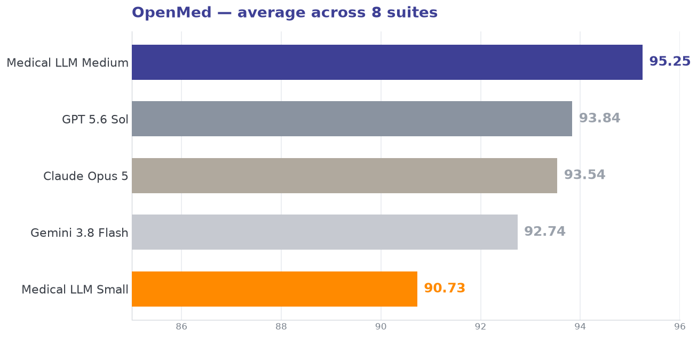
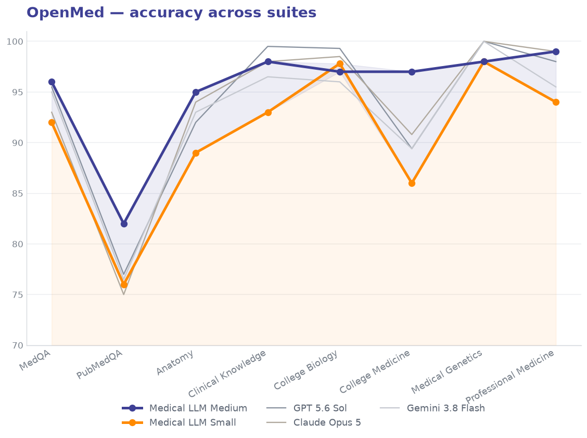
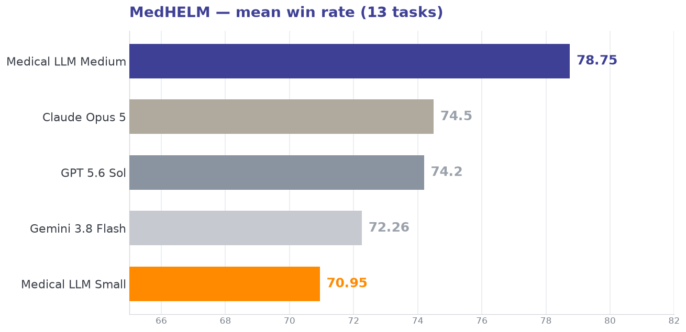
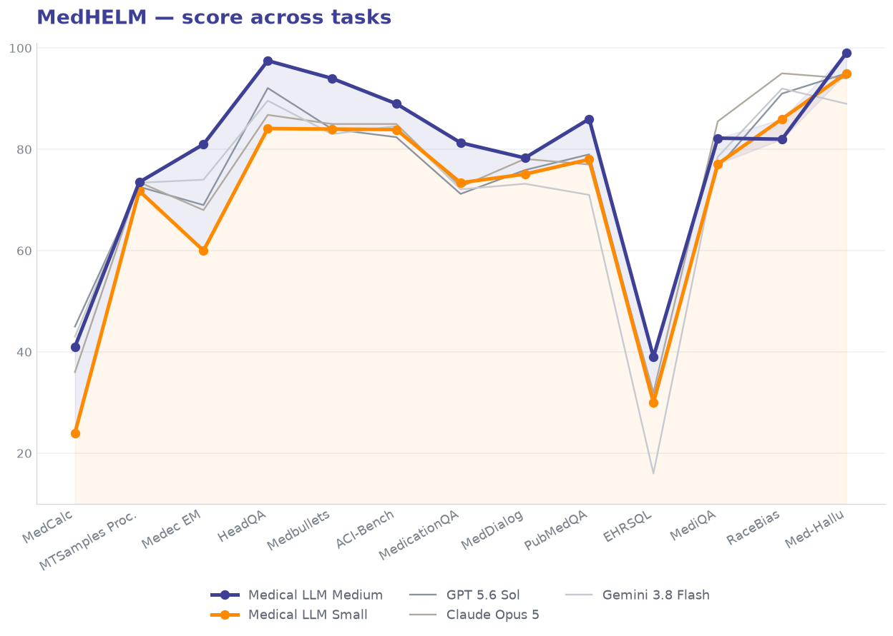
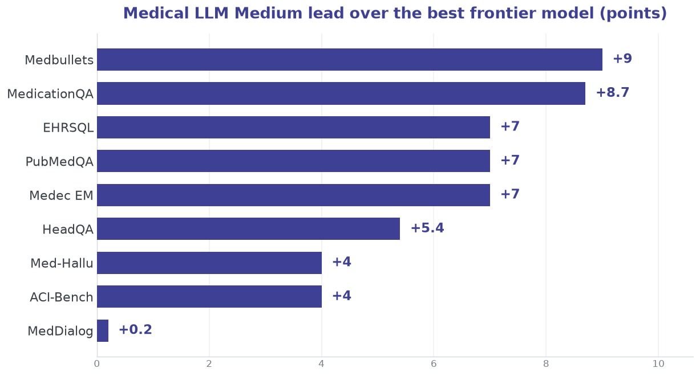
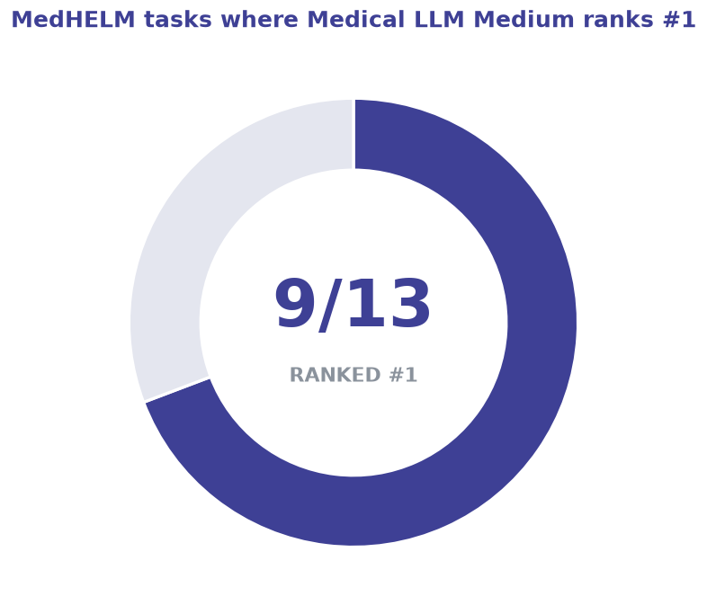
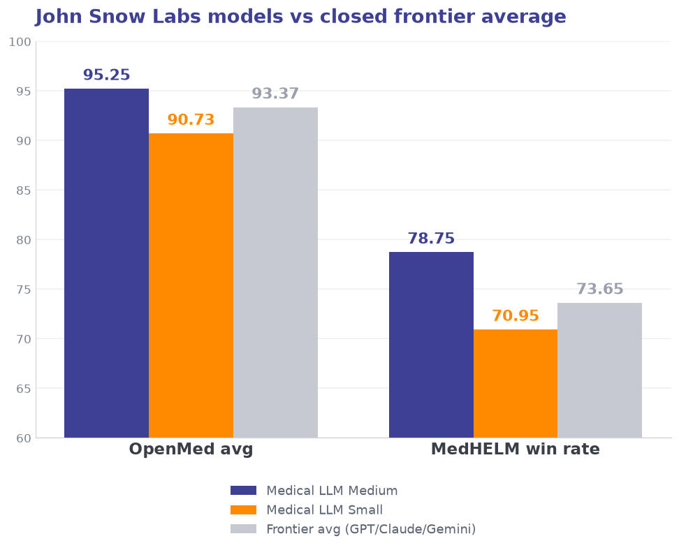
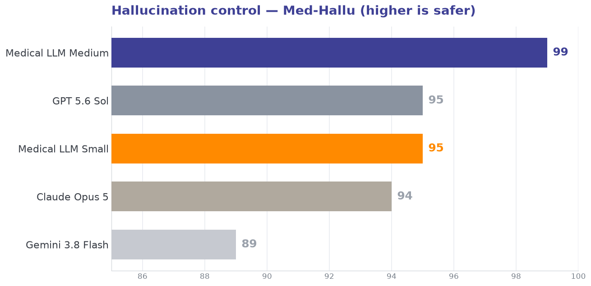
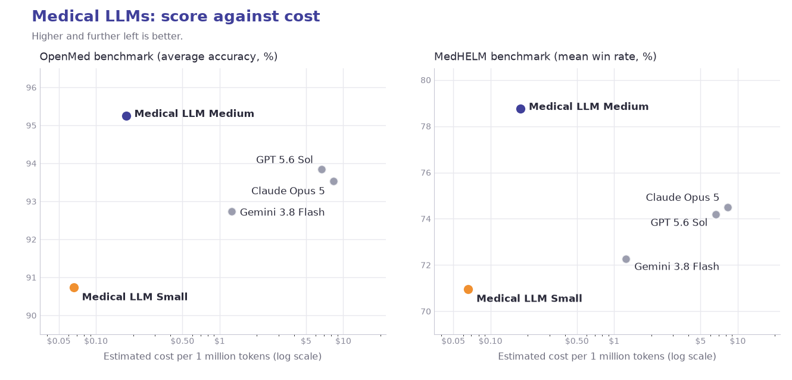

There is overwhelming evidence from both academic research and industry benchmarks that domain-specific, task-optimized large language models consistently outperform general-purpose LLMs in healthcare. At John Snow Labs, we've developed a focused pair of Medical LLMs purpose-built for clinical, biomedical, and life sciences applications.

**Medical LLM Medium** and **Medical LLM Small** are healthcare models benchmarked head-to-head against the leading closed frontier systems — GPT 5.6 Sol, Claude Opus 5, and Gemini 3.8 Flash — across the full spectrum of medical evaluation. Both are multimodal (text + image) and carry a locked John Snow Labs identity. Closed frontier models can't run on your data — ours can: licensed for on-premise or private-cloud deployment, HIPAA-friendly, without giving up frontier-grade medical accuracy.

## Medical LLMs Offering

{:.table-model-big}
| Model Name | Recommended GPU Memory | Max Sequence Length | Max KV-Cache | Tensor Parallel Sizes | Supported Platforms
|---|---|---|---|---|---|
| Medical LLM Medium | ~67 GB | 262K | 16 GB | 2, 4, 8 | [On-Premise](https://nlp.johnsnowlabs.com/docs/en/LLMs/on_prem_deploy)   [AWS](https://aws.amazon.com/marketplace/pp/prodview-z4jqmczvwgtby)   [Azure](https://marketplace.microsoft.com/en-us/product/johnsnowlabsinc1646051154808.medical_llm_medium?tab=Overview)   [Databricks](https://marketplace.databricks.com/details/6955d25d-2dda-4517-8a26-5dc3239e6995/John-Snow-Labs_MedicalLLMMedium)   [Snowflake](https://app.snowflake.com/marketplace/listing/GZTYZ4386LJI8/john-snow-labs-medical-llm-medium) |
| Medical LLM Small | ~25 GB | 262K | 8 GB | 1, 2, 4, 8 | [On-Premise](https://nlp.johnsnowlabs.com/docs/en/LLMs/on_prem_deploy)   [AWS](https://aws.amazon.com/marketplace/pp/prodview-yrajldynampw4)   [Azure](https://azuremarketplace.microsoft.com/en-us/marketplace/apps/johnsnowlabsinc1646051154808.medical_llm_small?tab=Overview)   [Databricks](https://marketplace.databricks.com/details/2d3cabaf-e93e-45e0-a954-82202000afd8/John-Snow-Labs_Medical-LLM-Small)   [Snowflake](https://app.snowflake.com/marketplace/listing/GZTYZ4386LJIC/john-snow-labs-medical-llm-small)  |

*Note: All memory calculations are based on half-precision (fp16/bf16) weights. Recommended GPU Memory considers the model size and the maximum key-value cache at the model's maximum sequence length. These calculations follow the guidelines from [DJL's LMI Deployment Guide](https://docs.djl.ai/master/docs/serving/serving/docs/lmi/deployment_guide/instance-type-selection.html).*

- **Medical LLM Small** — *Compact.* A compact medical LLM that outperforms much larger general models on MedHELM while running on a single commodity GPU.
- **Medical LLM Medium** — *Flagship.* Our best model — the #1 MedHELM mean win rate in this comparison, leading frontier closed models on OpenMed.

### Introduction

John Snow Labs' Medical Large Language Models advance Healthcare AI by setting state-of-the-art accuracy on medical LLM benchmarks while remaining small enough to deploy privately. This advances what's achievable across real-world use cases including clinical assessment, medical question answering, biomedical research synthesis, and diagnostic decision support.

What makes this release special is how strongly the models perform relative to their compute footprint. **Medical LLM Medium** posts the highest MedHELM mean win rate of every model tested (77.78) and leads the best closed frontier model on OpenMed (93.99). **Medical LLM Small** clears an OpenMed average of 90.63, making it practical for everyday use in hospitals and clinics where cost, speed, and privacy matter.

### OpenMed Benchmark Performance

The OpenMed evaluation framework represents one of the most rigorous testing environments for medical AI models, covering a broad spectrum of medical knowledge and clinical reasoning capabilities. It spans eight medical multiple-choice suites — MedQA, PubMedQA, and six MMLU medical subjects. Medical LLM Medium leads the best frontier model, while Medical LLM Small is remarkably strong for its size.

{:.table-model-big}
| Model | MedQA | PubMedQA | Anatomy | Clinical Knowledge | College Biology | College Medicine | Medical Genetics | Professional Medicine | Avg |
|---|---|---|---|---|---|---|---|---|---|
| **Medical LLM Medium** | **96** | **82** | **95** | 98 | 97 | **97** | 98 | **99** | **95.25** |
| **Medical LLM Small** | 92 | 76 | 89 | 93 | 97.8 | 86 | 98 | 94 | 90.73 |
| GPT 5.6 Sol | 95.5 | 77 | 92 | **99.5** | **99.3** | 89.4 | **100** | 98 | 93.84 |
| Claude Opus 5 | 93 | 75 | 94 | 98 | 98.5 | 90.8 | **100** | 99 | 93.54 |
| Gemini 3.8 Flash | 95 | 76.5 | 93 | 96.5 | 96 | 89.4 | **100** | 95.5 | 92.74 |

> **Frontier-leading accuracy — private by design.** Medical LLM Medium scores 95.25 on OpenMed — ahead of GPT 5.6 Sol (93.84) and Claude Opus 5 (93.54) — while being licensed for deployment inside your firewall. Medical LLM Small clears 90 while staying compact enough to run on a single commodity GPU.

### MedHELM Benchmark Analysis

MedHELM spans thirteen clinical tasks across documentation, coding, safety, dialogue, and reasoning. Medical LLM Medium posts the highest mean win rate of every model tested, and records the best score on 12 of the 13 tasks.

{:.table-model-big}
| Benchmark | Medical LLM Medium | Medical LLM Small | GPT 5.6 Sol | Claude Opus 5 | Gemini 3.8 Flash |
|---|---|---|---|---|---|
| **Mean win rate** | **78.75**          | 70.95             | 74.20       | 74.50         | 72.26            |
| MedCalc           | 41                 | 24                | **45**      | 36            | 43               |
| MTSamples Proc.   | **73.5**           | 71.8              | 72.6        | **73.5**      | 73.4             |
| Medec EM          | **81**             | 60                | 69          | 68            | 74               |
| HeadQA            | **97.5**           | 84.1              | 92.1        | 86.8          | 89.6             |
| Medbullets        | **94**             | 84                | 84          | 85            | 83               |
| ACI-Bench         | **89**             | 83.9              | 82.4        | 85            | 84.6             |
| MedicationQA      | **81.3**           | 73.4              | 71.2        | 72.6          | 72.1             |
| MedDialog         | **78.3**           | 75.1              | 75.9        | 78.1          | 73.2             |
| PubMedQA          | **86**             | 78                | 79          | 77            | 71               |
| EHRSQL            | **39**             | 30                | 31          | 32            | 16               |
| MediQA            | 82.2               | 77.1              | 76.4        | **85.5**      | 78.5             |
| RaceBias          | 82                 | 79                | 91          | **95**        | 92               |
| Med-Hallu         | **99**             | 95                | 95          | 94            | 89               |

> Medical LLM Medium records the best score on 9 of the 13 MedHELM tasks outright (plus a tie with Claude Opus 5 on MTSamples Proc.), with its largest margins on board-style reasoning (Medbullets +9), medication QA (+8.7), and a three-way tie at +7 on clinical error detection (Medec), biomedical research comprehension (PubMedQA), and database reasoning (EHRSQL).

### How the Models Compare

Three signals matter for a clinical deployment: how often the model ranks first, whether a John Snow Labs model can match closed frontier systems, and how well it resists hallucination.

Medical LLM Medium leads the closed frontier on OpenMed (95.25 vs 93.37 average) while beating it outright on MedHELM (78.75 vs 73.65 average). On hallucination control — the metric that decides whether a model is safe in front of clinicians — Medical LLM Medium leads the full field at 99, with Medical LLM Small tied for second at 95.

### Red-Teaming Evaluation Results

Out of 1000 red-teaming questions across 148 medical categories, Medical LLM Medium passed about 950 (95%), compared to 830 for GPT-5.6 Sol (83%), 940 for Claude Opus 5 (94%), and only 810 for Gemini 3.8 Flash (81%) — making Medical LLM Medium the most robust model in this evaluation and outperforming larger private models despite its smaller size.

### Cost Analysis

Running a language model privately means paying for GPU time instead of paying per token. This section compares the estimated cost of processing text with Medical LLM Small and Medical LLM Medium on rented GPUs with the list API prices of the frontier models used in the benchmarks above.

#### Estimated Infrastructure Cost

{:.table-model-big}
| Metric | Medical LLM Small | Medical LLM Medium |
|:---|---:|---:|
| Reference hardware | 1x A100 (40 GB) | 1x H100 (80 GB) |
| Throughput (64 concurrent requests) | 8,323 tokens/s | 6,685 tokens/s |
| Assumed GPU cost per hour | $1.99 | $4.20 |
| Estimated cost per 1 million tokens | ~$0.066 | ~$0.175 |

#### Comparison with Frontier Models

Cost per 1 million tokens for a workload of 1,000 input tokens and 200 output tokens per request (5 parts input to 1 part output). Frontier models are priced at their API list prices.

{:.table-model-big}
| Model | Input price (per 1M tokens) | Output price (per 1M tokens) | Cost per 1M tokens | Relative to Medical LLM Medium |
|:---|---:|---:|---:|---:|
| Medical LLM Small | | | ~$0.066 | ~0.4x |
| Medical LLM Medium | | | ~$0.175 | 1x |
| Gemini 3.8 Flash | $0.75 | $3.75 | $1.25 | ~7x |
| GPT 5.6 Sol | $4.00 | $20.00 | $6.67 | ~38x |
| Claude Opus 5 | $5.00 | $25.00 | $8.33 | ~48x |

**At a steady workload, Medical LLM Medium costs about 38 times less than GPT 5.6 Sol and about 48 times less than Claude Opus 5 for the same text volume.** 

#### Score and Cost

Medical LLM Medium scores higher than the three frontier models on both OpenMed and MedHELM, at an estimated cost per token that is 7 to 48 times lower.

#### Cost Projection by Processing Volume

Assuming linear scaling of tokens processed and compute costs:

{:.table-model-big}
| Number of tokens | Medical LLM Small | Medical LLM Medium | Gemini 3.8 Flash | GPT 5.6 Sol | Claude Opus 5 |
|---:|---:|---:|---:|---:|---:|
| 100 million | ~$6.60 | ~$17.50 | $125 | $667 | $833 |
| 1 billion | ~$66 | ~$175 | $1,250 | $6,667 | $8,333 |
| 10 billion | ~$660 | ~$1,750 | $12,500 | $66,667 | $83,333 |

Note: The GPU hourly rates of $1.99 and $4.20 are illustrative pricing assumptions and are not official John Snow Labs prices.

