

There is overwhelming evidence from both academic research and industry benchmarks that domain-specific, task-optimized large language models consistently outperform general-purpose LLMs in healthcare. At John Snow Labs, we've developed a focused pair of Medical LLMs purpose-built for clinical, biomedical, and life sciences applications.

**Medical LLM Medium** and **Medical LLM Small** are healthcare models benchmarked head-to-head against the leading closed frontier systems — GPT 5.6 Sol, Claude Opus 5, and Gemini 3.8 Flash — across the full spectrum of medical evaluation. Both are multimodal (text + image) and carry a locked John Snow Labs identity. Closed frontier models can't run on your data — ours can: licensed for on-premise or private-cloud deployment, HIPAA-friendly, without giving up frontier-grade medical accuracy.

## Medical LLMs Offering

{:.table-model-big}
| Model Name | Recommended GPU Memory | Max Sequence Length | Max KV-Cache | Tensor Parallel Sizes | Supported Platforms
|---|---|---|---|---|---|
| Medical LLM Medium | ~67 GB | 262K | 16 GB | 2, 4, 8 | [On-Premise](https://nlp.johnsnowlabs.com/docs/en/LLMs/on_prem_deploy)   [AWS](https://aws.amazon.com/marketplace/pp/prodview-z4jqmczvwgtby)   [Azure](https://marketplace.microsoft.com/en-us/product/johnsnowlabsinc1646051154808.medical_llm_medium?tab=Overview)   [Databricks](https://marketplace.databricks.com/details/6955d25d-2dda-4517-8a26-5dc3239e6995/John-Snow-Labs_MedicalLLMMedium)   [Snowflake](https://app.snowflake.com/marketplace/listing/GZTYZ4386LJI8/john-snow-labs-medical-llm-medium) |
| Medical LLM Small | ~25 GB | 262K | 8 GB | 1, 2, 4, 8 | [On-Premise](https://nlp.johnsnowlabs.com/docs/en/LLMs/on_prem_deploy)   [AWS](https://aws.amazon.com/marketplace/pp/prodview-yrajldynampw4)   [Azure](https://azuremarketplace.microsoft.com/en-us/marketplace/apps/johnsnowlabsinc1646051154808.medical_llm_small?tab=Overview)   [Databricks](https://marketplace.databricks.com/details/2d3cabaf-e93e-45e0-a954-82202000afd8/John-Snow-Labs_Medical-LLM-Small)   [Snowflake](https://app.snowflake.com/marketplace/listing/GZTYZ4386LJIC/john-snow-labs-medical-llm-small)  |

*Note: All memory calculations are based on half-precision (fp16/bf16) weights. Recommended GPU Memory considers the model size and the maximum key-value cache at the model's maximum sequence length. These calculations follow the guidelines from [DJL's LMI Deployment Guide](https://docs.djl.ai/master/docs/serving/serving/docs/lmi/deployment_guide/instance-type-selection.html).*

- **Medical LLM Small** — *Compact.* A compact medical LLM that outperforms much larger general models on MedHELM while running on a single commodity GPU.
- **Medical LLM Medium** — *Flagship.* Our best model — the #1 MedHELM mean win rate in this comparison, leading frontier closed models on OpenMed.

### Introduction

John Snow Labs' Medical Large Language Models advance Healthcare AI by setting state-of-the-art accuracy on medical LLM benchmarks while remaining small enough to deploy privately. This advances what's achievable across real-world use cases including clinical assessment, medical question answering, biomedical research synthesis, and diagnostic decision support.

What makes this release special is how strongly the models perform relative to their compute footprint. **Medical LLM Medium** posts the highest MedHELM mean win rate of every model tested (77.78) and leads the best closed frontier model on OpenMed (93.99). **Medical LLM Small** clears an OpenMed average of 90.63, making it practical for everyday use in hospitals and clinics where cost, speed, and privacy matter.

### OpenMed Benchmark Performance

The OpenMed evaluation framework represents one of the most rigorous testing environments for medical AI models, covering a broad spectrum of medical knowledge and clinical reasoning capabilities. It spans eight medical multiple-choice suites — MedQA, PubMedQA, and six MMLU medical subjects. Medical LLM Medium leads the best frontier model, while Medical LLM Small is remarkably strong for its size.

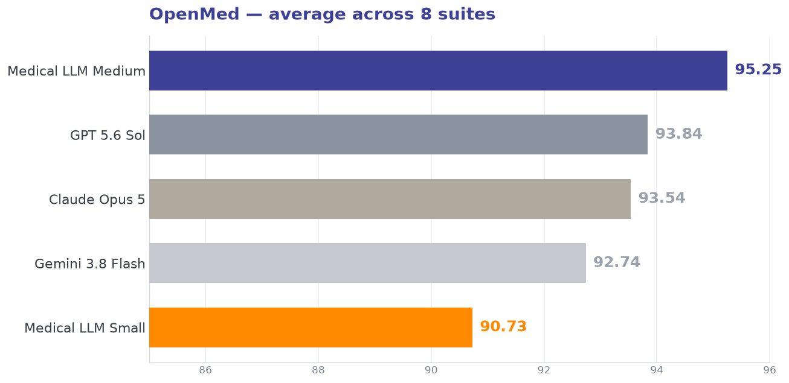

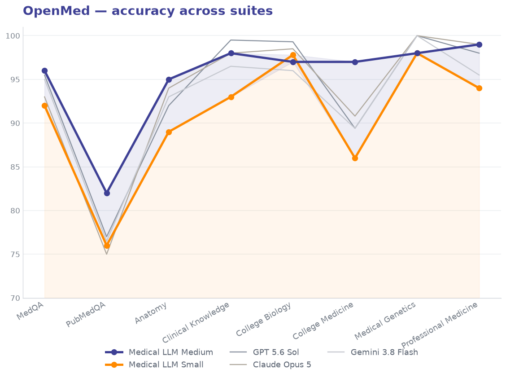

{:.table-model-big}
| Model | MedQA | PubMedQA | Anatomy | Clinical Knowledge | College Biology | College Medicine | Medical Genetics | Professional Medicine | Avg |
|---|---|---|---|---|---|---|---|---|---|
| **Medical LLM Medium** | **96** | **82** | **95** | 98 | 97 | **97** | 98 | **99** | **95.25** |
| **Medical LLM Small** | 92 | 76 | 89 | 93 | 97.8 | 86 | 98 | 94 | 90.73 |
| GPT 5.6 Sol | 95.5 | 77 | 92 | **99.5** | **99.3** | 89.4 | **100** | 98 | 93.84 |
| Claude Opus 5 | 93 | 75 | 94 | 98 | 98.5 | 90.8 | **100** | 99 | 93.54 |
| Gemini 3.8 Flash | 95 | 76.5 | 93 | 96.5 | 96 | 89.4 | **100** | 95.5 | 92.74 |

> **Frontier-leading accuracy — private by design.** Medical LLM Medium scores 95.25 on OpenMed — ahead of GPT 5.6 Sol (93.84) and Claude Opus 5 (93.54) — while being licensed for deployment inside your firewall. Medical LLM Small clears 90 while staying compact enough to run on a single commodity GPU.

### MedHELM Benchmark Analysis

MedHELM spans thirteen clinical tasks across documentation, coding, safety, dialogue, and reasoning. Medical LLM Medium posts the highest mean win rate of every model tested, and records the best score on 12 of the 13 tasks.

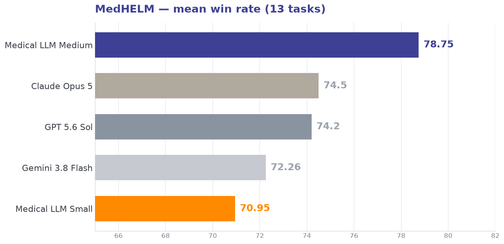

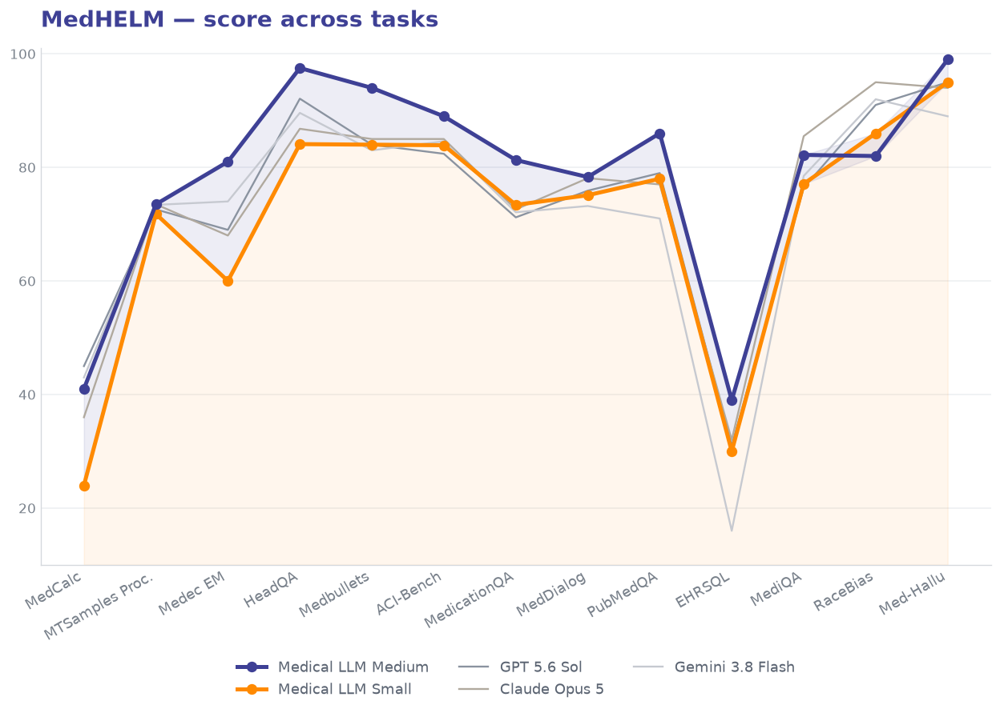

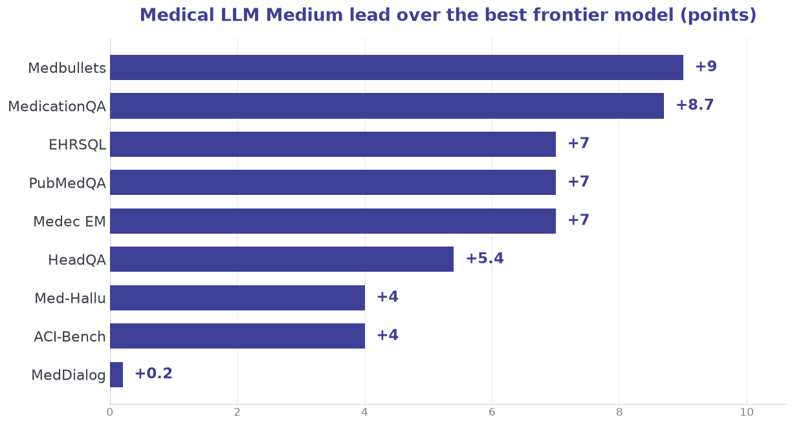

{:.table-model-big}
| Benchmark | Medical LLM Medium | Medical LLM Small | GPT 5.6 Sol | Claude Opus 5 | Gemini 3.8 Flash |
|---|---|---|---|---|---|
| **Mean win rate** | **78.75**          | 70.95             | 74.20       | 74.50         | 72.26            |
| MedCalc           | 41                 | 24                | **45**      | 36            | 43               |
| MTSamples Proc.   | **73.5**           | 71.8              | 72.6        | **73.5**      | 73.4             |
| Medec EM          | **81**             | 60                | 69          | 68            | 74               |
| HeadQA            | **97.5**           | 84.1              | 92.1        | 86.8          | 89.6             |
| Medbullets        | **94**             | 84                | 84          | 85            | 83               |
| ACI-Bench         | **89**             | 83.9              | 82.4        | 85            | 84.6             |
| MedicationQA      | **81.3**           | 73.4              | 71.2        | 72.6          | 72.1             |
| MedDialog         | **78.3**           | 75.1              | 75.9        | 78.1          | 73.2             |
| PubMedQA          | **86**             | 78                | 79          | 77            | 71               |
| EHRSQL            | **39**             | 30                | 31          | 32            | 16               |
| MediQA            | 82.2               | 77.1              | 76.4        | **85.5**      | 78.5             |
| RaceBias          | 82                 | 79                | 91          | **95**        | 92               |
| Med-Hallu         | **99**             | 95                | 95          | 94            | 89               |

> Medical LLM Medium records the best score on 9 of the 13 MedHELM tasks outright (plus a tie with Claude Opus 5 on MTSamples Proc.), with its largest margins on board-style reasoning (Medbullets +9), medication QA (+8.7), and a three-way tie at +7 on clinical error detection (Medec), biomedical research comprehension (PubMedQA), and database reasoning (EHRSQL).

### How the Models Compare

Three signals matter for a clinical deployment: how often the model ranks first, whether a John Snow Labs model can match closed frontier systems, and how well it resists hallucination.

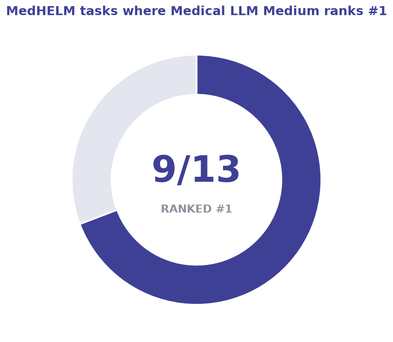

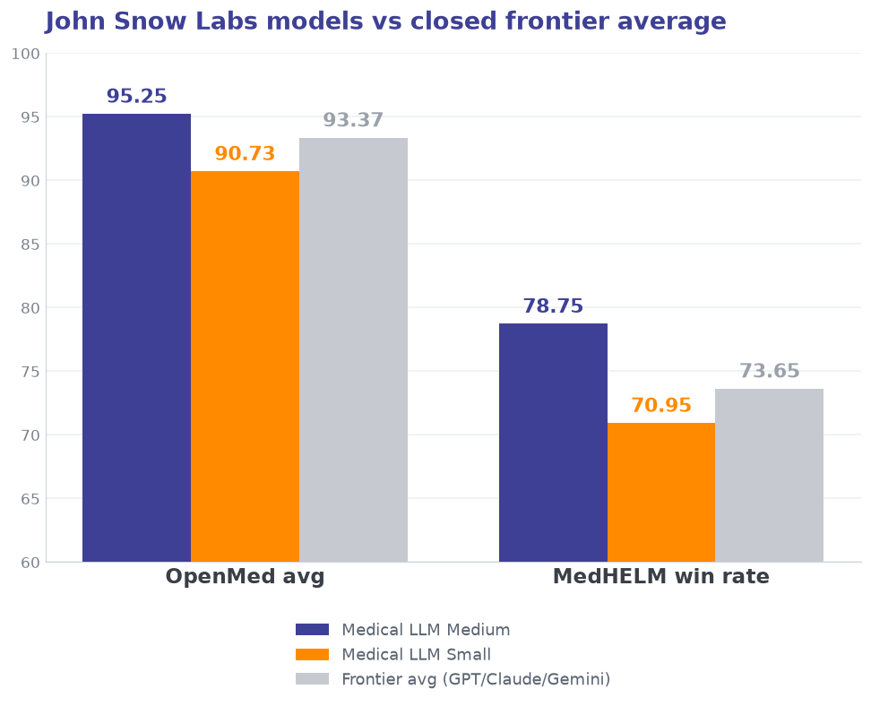

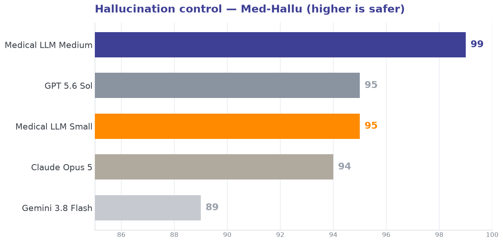

Medical LLM Medium leads the closed frontier on OpenMed (95.25 vs 93.37 average) while beating it outright on MedHELM (78.75 vs 73.65 average). On hallucination control — the metric that decides whether a model is safe in front of clinicians — Medical LLM Medium leads the full field at 99, with Medical LLM Small tied for second at 95.

### Red-Teaming Evaluation Results

Out of 1000 red-teaming questions across 148 medical categories, Medical LLM Medium passed about 950 (95%), compared to 830 for GPT-5.6 Sol (83%), 940 for Claude Opus 5 (94%), and only 810 for Gemini 3.8 Flash (81%) — making Medical LLM Medium the most robust model in this evaluation and outperforming larger private models despite its smaller size.

## Medical Small LLMs

John Snow Labs offers a curated portfolio of **specialized small language models (1B-10B parameters), alongside larger, more capable models**. Designed for real-world deployment, these models are **quantized for efficiency and can run on standard CPU-based hardware without requiring a GPU**, while also supporting GPU acceleration for improved performance. They integrate seamlessly with the **Healthcare NLP library**, just like any other component, and are fully included under the **Healthcare NLP license**.

{:.table-model-big.db}
| Model Name   | Disk Size   | Model Size | Modality   | Available quantizations | GPU Memory   Required | Token/sec | Max Context   Window | Tasks |
| ------------ | ----------- | ---------- | ---------- | ------------------------| ------------------------ | --------- | ----------------------- | ----- |
| JSL_MedM_v3            | [8.2G, 14G, 21.9G]  | 14B        | text-only  | [[q4](https://nlp.johnsnowlabs.com/2024/10/06/jsl_medm_q4_v3_en.html), [q8](https://nlp.johnsnowlabs.com/2024/10/08/jsl_medm_q8_v3_en.html), [q16](https://nlp.johnsnowlabs.com/2024/10/23/jsl_medm_q16_v3_en.html)]                                  | 24GB                | [79, 84, 253]      | 32,768             | Summarization, Q&A, RAG, and Chat |
| JSL_MedS_v3            | [2.2G, 3.7G, 5.6G]  | 3.5B       | text-only  | [[q4](https://nlp.johnsnowlabs.com/2024/10/05/jsl_meds_q4_v3_en.html), [q8](https://nlp.johnsnowlabs.com/2024/10/05/jsl_meds_q8_v3_en.html), [q16](https://nlp.johnsnowlabs.com/2024/10/05/jsl_meds_q16_v3_en.html)]                                  | 10GB                | [28.5, 18.7, 50.2] | 131,072            | Summarization, Q&A, RAG |
| JSL_MedS_4B_v5         | [2.4G, 4.0G, 6.1G]  | 4B         | text-only  | [[q4](https://nlp.johnsnowlabs.com/2025/08/05/jsl_meds_4b_q4_v5_en.html), [q8](https://nlp.johnsnowlabs.com/2025/08/05/jsl_meds_4b_q8_v5_en.html), [q16](https://nlp.johnsnowlabs.com/2025/08/05/jsl_meds_4b_q16_v5_en.html)]                         | 16GB                | [40, 32, 95]       | 32,768             | Summarization, Q&A, RAG |
| JSL_MedS_8B_v4         | [4.6G, 7.8G, 12.2G] | 8B         | text-only  | [[q4](https://nlp.johnsnowlabs.com/2025/08/05/jsl_meds_8b_q4_v4_en.html), [q8](https://nlp.johnsnowlabs.com/2025/08/05/jsl_meds_8b_q8_v4_en.html), [q16](https://nlp.johnsnowlabs.com/2025/08/05/jsl_meds_8b_q16_v4_en.html)]                         | 16GB                | [83, 84, 272]      | 32,768             | Summarization, Q&A, RAG |
| JSL_MedS_NER_v4        | [2.2G, 3.7G, 6.0]   | 3.5B       | text-only  | [[q4](https://nlp.johnsnowlabs.com/2025/07/01/jsl_meds_ner_q4_v4_en.html), [q8](https://nlp.johnsnowlabs.com/2025/07/01/jsl_meds_ner_q8_v4_en.html), [q16](https://nlp.johnsnowlabs.com/2025/07/01/jsl_meds_ner_q16_v4_en.html)]                      | 10GB                | [28.5, 18.7]       | 131,072            | Extract and link medical named entities |
| JSL_MedS_NER_v5        | 6.0G                | 3.5B       | text-only  | [q16](https://nlp.johnsnowlabs.com/2026/04/09/jsl_meds_ner_q16_v5_en.html)                                                                                                                                                                            | 10GB                | —                  | 131,072            | Clinical trial eligibility parsing |
| JSL_MedS_RAG_v1        | [2.2G, 3.7G, 5.6G]  | 3B         | text-only  | [[q4](https://nlp.johnsnowlabs.com/2024/10/05/jsl_meds_rag_q4_v1_en.html), [q8](https://nlp.johnsnowlabs.com/2024/10/05/jsl_meds_rag_q8_v1_en.html), [q16](https://nlp.johnsnowlabs.com/2024/10/05/jsl_meds_rag_q16_v1_en.html)]                      | 10GB                | [30, 20, 53]       | 32,768             | LLM component of Retrieval Augmented Generation (RAG) |
| JSL_MedS_Text2SOAP_v1  | 2.2G                | 3B         | text-only  | [base](https://nlp.johnsnowlabs.com/2025/04/09/jsl_meds_text2soap_v1_en.html) | 10GB                | 53                 | 32,768             | Generate structured SOAP (Subjective, Objective, Assessment, Plan) summaries |
| JSL_MedS_VLM_3B_v1     | [2.5G, 3.6G, 5.6G]  | 3B         | multimodal | [[q4](https://nlp.johnsnowlabs.com/2025/08/08/jsl_meds_vlm_3b_q8_v1_en.html), [q8](https://nlp.johnsnowlabs.com/2025/08/08/jsl_meds_vlm_3b_q4_v1_en.html), [q16](https://nlp.johnsnowlabs.com/2025/08/08/jsl_meds_vlm_3b_q16_v1_en.html)]             | 10GB                | [8, 11, 40.1]      | 128,000            | Extract and link structured medical named entities |
| JSL_MedS_NER_VLM_2B_v2 | [1.5G, 2.1G, 3.3G]  | 2B         | multimodal | [[q4](https://nlp.johnsnowlabs.com/2025/08/10/jsl_meds_ner_vlm_2b_q4_v2_en.html), [q8](https://nlp.johnsnowlabs.com/2025/08/10/jsl_meds_ner_vlm_2b_q8_v2_en.html), [q16](https://nlp.johnsnowlabs.com/2025/08/10/jsl_meds_ner_vlm_2b_q16_v2_en.html)] | 10GB                | [25.5, 13.7, 48.9] | 32,768             | Extract and link structured medical named entities |

**You can explore these models on our** [Colab notebook](https://colab.research.google.com/github/JohnSnowLabs/spark-nlp-workshop/blob/master/healthcare-nlp/36.0.Loading_Medical_and_Open_Source_LLMs.ipynb "https://colab.research.google.com/github/johnsnowlabs/spark-nlp-workshop/blob/master/healthcare-nlp/36.0.loading_medical_and_open_source_llms.ipynb") **and see how these models can enhance your healthcare workflows.**

## Vision OCR

Industry Benchmarks and Academic Research strongly agree that Task-optimized OCR models beat general-purpose frontier systems on crucial tasks for document pipelines: grounding every token to a precise bounding box, and turning a page into schema-valid structured output.
At John Snow Labs, we've built a focused pair of OCR models for exactly those tasks.

**Vision OCR LLM** and **Vision OCR Structured LLM** are benchmarked head-to-head against the leading closed frontier systems (GPT 5.5, Claude Opus 4.8, and Gemini 3.5 Flash) across table structure, bounding-box grounding, and structured JSON. Closed frontier models should not run on patient records, ours can. 
Licensed for on-premise or private cloud deployment, keeps PII and PHI inside your infrastructure, HIPAA-friendly, without giving up accuracy where it matters most.

### Vision OCR Offering

| Model Name | Recommended GPU Memory | Max Sequence Length | Max KV-Cache | Tensor Parallel Sizes | Supported Platforms
|---|---|---|---|---|---|
| Vision-OCR-LLM | ~6 GB | 32K | 4 GB | 1, 2, 4 | [On-Premise](https://nlp.johnsnowlabs.com/docs/en/LLMs/on_prem_deploy)   [AWS](https://aws.amazon.com/marketplace/pp/prodview-d7un4r7xpiwje)   [Azure](https://marketplace.microsoft.com/en-us/product/virtual-machine/johnsnowlabsinc1646051154808.visual_language_ocr_llm?tab=Overview)   [Databricks](https://marketplace.databricks.com/details/c90c05de-8957-443d-8e1d-b73358d82b67/John-Snow-Labs_Vision-OCR-LLM)   [Snowflake](https://app.snowflake.com/marketplace/listing/GZTYZ4386LJXB/john-snow-labs-vision-ocr-llm) |
| Vision-OCR-Structured-LLM | ~32 GB | 128K | 17 GB | 1, 2, 4 | [On-Premise](https://nlp.johnsnowlabs.com/docs/en/LLMs/on_prem_deploy)   [AWS](https://aws.amazon.com/marketplace/pp/prodview-rrpnzcxjmhtfy)   [Azure](https://marketplace.microsoft.com/en-us/product/virtual-machine/johnsnowlabsinc1646051154808.visual_language_ocr_structured_llm?tab=Overview)   [Databricks](https://marketplace.databricks.com/details/e5063101-57bb-4523-baa0-48da9cf6d4ab/John-Snow-Labs_Vision-OCR-Structured)    [Snowflake](https://app.snowflake.com/marketplace/listing/GZTYZ4386LJXF/john-snow-labs-vision-ocr-structured-llm) |

*Note: bf16 serving, GB = 10⁹ bytes. Recommended GPU Memory covers measured model weights, KV cache at each model's max context (128K for Vision OCR Structured LLM, 32K for Vision OCR LLM), and ~8% activation/runtime overhead, per [DJL's LMI Deployment Guide](https://docs.djl.ai/master/docs/serving/serving/docs/lmi/deployment_guide/instance-type-selection.html). Typical OCR context (~8K) is far smaller — ~19 GB / ~3 GB, single-GPU.*

- **Vision OCR LLM**: *Grounding specialist.* Word-level OCR with precise bounding boxes, single-GPU. [AWS Marketplace](https://aws.amazon.com/marketplace/pp/prodview-d7un4r7xpiwje?sr=0-3&ref_=beagle&applicationId=AWSMPContessa)
- **Vision OCR Structured LLM**: *Structure specialist.* Document to schema-constrained JSON. [AWS Marketplace](https://aws.amazon.com/marketplace/pp/prodview-rrpnzcxjmhtfy?applicationId=AWSMPContessa&ref_=beagle&sr=0-1)

### Introduction

John Snow Labs' Vision OCR models hit competitive accuracy on the benchmarks that matter in production while staying small enough to deploy privately. **Vision OCR LLM** posts the top table-structure score of every model tested (0.784 TEDS-S) and top-tier grounding (0.938) on a single commodity GPU; **Vision OCR Structured LLM** handles schema-constrained JSON extraction (0.708) ahead of two of the three closed frontier systems. All models run inside your firewall, where the closed frontier cannot, ideal for hospitals and clinics where cost, speed, and privacy matter.

### Table Structure Recognition Performance

TEDS-S (structure-only tree-edit-distance similarity) scores table-structure recovery on a complexity-balanced 50-table slice of PubTabNet. Vision OCR LLM beats every closed frontier model.

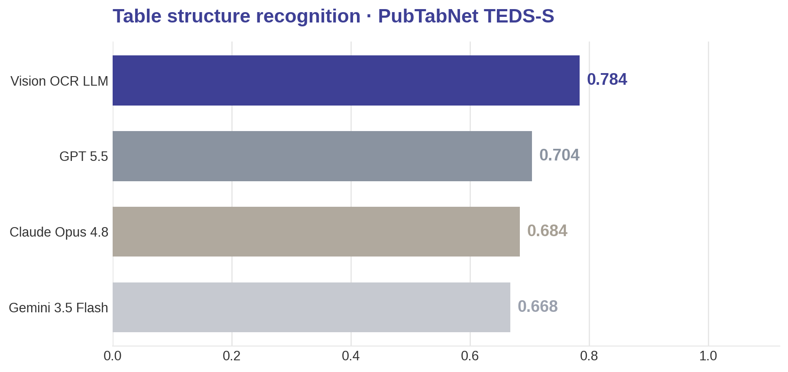

{:.table-model-big}
| Model | TEDS-S |
|---|---|
| **Vision OCR LLM** | **0.784** |
| GPT 5.5 | 0.704 |
| Claude Opus 4.8 | 0.684 |
| Gemini 3.5 Flash | 0.668 |

> **Leads the frontier on table structure, privately.** Vision OCR LLM posts the highest TEDS-S of every model tested (0.784), 8 points ahead of the best frontier system, running single-GPU inside your firewall.

*Dataset: PubTabNet validation set. 50 tables selected by structural complexity — every table scored (spanning cells, row and cell counts), split into 5 complexity quintiles, 10 sampled evenly from each — so the slice spans simple to very dense rather than favoring either. All four models on the identical 50.*

### Bounding-Box Grounding OCR Performance

Grounding is scored on FUNSD as 1 minus canonical CER (the reading-order, region-matched metric behind our published AWS Marketplace figure).
Predicted boxes are first IoU-matched to gold regions (0.78 overlap threshold), then CER measures how accurately it read the text inside those matched regions. Vision OCR LLM lands in the top tier, ahead of GPT 5.5 and Claude Opus 4.8, and is the only model here that pairs a top-tier score with full-page coverage.

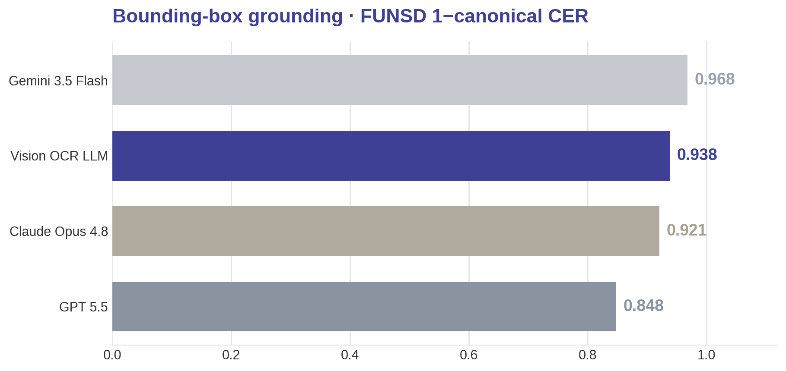

{:.table-model-big}
| Model | 1 − canonical CER |
|---|---|
| **Vision OCR LLM** | 0.938 |
| GPT 5.5 | 0.848 |
| Claude Opus 4.8 | 0.921 |
| Gemini 3.5 Flash | **0.968** |

> **Top-tier grounding, full-page coverage.** Vision OCR LLM scores 0.938, ahead of GPT 5.5 and Claude Opus 4.8. Canonical CER rewards only tightly localized regions, so a high frontier score can mean partial page coverage; Vision OCR LLM combines its score with full-page coverage.

*Dataset: FUNSD official 2019 test split — all 50 test forms (the complete test set, not a sub-sample), with word-level box + text ground truth. All four models on the identical 50.*

### Structured JSON Extraction

OmniOCR scores schema-constrained document-to-JSON as field accuracy, the task production extraction pipelines are built on. Vision OCR Structured LLM is competitive with the frontier, ahead of GPT 5.5 and Claude Opus 4.8, and matches its published AWS Marketplace figure (0.714).

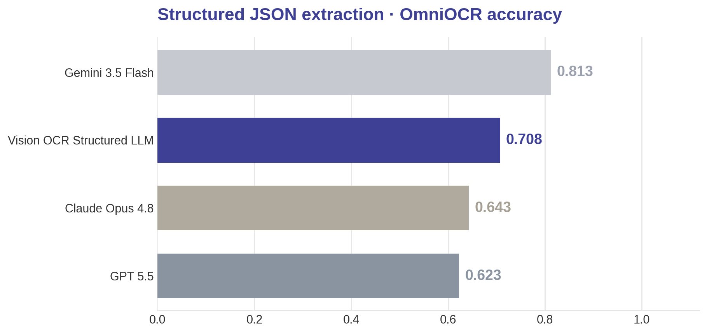

{:.table-model-big}
| Model | JSON accuracy |
|---|---|
| **Vision OCR Structured LLM** | 0.708 |
| GPT 5.5 | 0.623 |
| Claude Opus 4.8 | 0.643 |
| Gemini 3.5 Flash | **0.813** |

> **Frontier-competitive structured extraction, private by design.** Vision OCR Structured LLM reaches 0.708 JSON accuracy, ahead of GPT 5.5 and Claude Opus 4.8, while licensed for deployment inside your firewall.

*Dataset: OmniOCR (`getomni-ai/ocr-benchmark`, pinned revision), test split — the first 100 documents. All four models on the identical 100.*

### How the Models Compare

Across all three task families, a John Snow Labs model beats the closed-frontier average, each model shown on its target task.

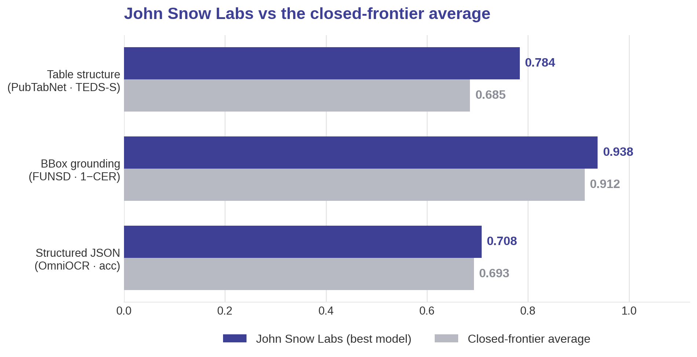

Vision OCR LLM leads on table structure (0.784) and top-tier grounding (0.938, with full-page coverage); Vision OCR Structured LLM stays ahead of two of three frontier systems on structured JSON. The whole family runs single-GPU on-premise, which the closed frontier cannot.

*All numbers measured on our own harness under identical conditions (same prompt, 0 errored docs). BBox is shown as 1 − canonical CER (higher is better) — the reading-order, region-matched metric behind our published AWS Marketplace figures (raw canonical CER 0.039 for Vision OCR LLM on FUNSD; 0.714 JSON accuracy for Vision OCR Structured LLM on OmniOCR).*

## Medical Decision Models (DMs)

Task-optimized models consistently outperform general-purpose models on focused clinical decisions. At John Snow Labs, we have built Medical Decision Models (DMs): compact models that answer typed questions about clinical text, such as whether a note documents a condition, whether a drug caused an event, or whether a trial accepts a patient. A question can ask the model to pick one option, answer yes or no with a probability, or choose an ordered level.

Medical DMs are small enough to deploy privately, and the smallest run on a CPU. The question and its options are part of the input, so a new rule or a new threshold needs no retraining.

### Medical Decision Models (DMs) Offering

{:.table-model-big}
| Model Name | Best for | Runs on | Recommended Memory | Max Sequence Length | Supported Platforms |
|:---|:---|:---|:---|:---|:---|
| Medical DM Small | Highest average score across the nine task areas | GPU | ~16 GB GPU VRAM | 16K | On-Premise, AWS, Azure, Databricks, Snowflake |
| Medical DM Nano | Compact; runs on a single small GPU or on CPU | GPU or CPU | ~2 GB GPU VRAM | 16K | On-Premise, AWS, Azure, Databricks, Snowflake |
| PHI Guard v0.6 | Gate de-identified notes | CPU, ONNX | ~1 GB RAM | 8K | Healthcare NLP library, Models Hub |
| PHI Guard v0.6 Fast | The same gate when speed matters most | CPU, ONNX | ~1 GB RAM | 8K | Healthcare NLP library, Models Hub |
| PHI Guard Masked v0.6 | De-identified gate with a final fine-tuning step | CPU, ONNX | ~1 GB RAM | 8K | Healthcare NLP library, Models Hub |
| PHI Guard Raw v0.6 | Route or skip PHI-free raw notes | CPU, ONNX | ~1 GB RAM | 8K | Healthcare NLP library, Models Hub |
| PHI Guard Richness v0.6 | How much PHI a note exposes (levels 0 to 6) | CPU, ONNX | ~1 GB RAM | 8K | Healthcare NLP library, Models Hub |
| PHI Guard v0.7 | Leak, harm, richness and raw in one call | CPU, ONNX | ~1 GB RAM | 8K | Healthcare NLP library, Models Hub |
| PHI Guard v0.7 Fast | The same outputs, about 5x faster | CPU, ONNX | ~1 GB RAM | 8K | Healthcare NLP library, Models Hub |

Note: Recommended memory assumes half-precision (bf16) weights plus working memory at the maximum sequence length: GPU VRAM for the GPU models and RAM for the CPU models. The PHI Guard models are included in the Healthcare NLP library and run on CPU with ONNX.

<!-- TODO: link the PHI Guard models to their Models Hub pages (links from Danielo); add the tiny decision models later. -->

**Medical DM Small** is our best-scoring decision model across nine medical task areas, and **Medical DM Nano** is the compact option that runs on a single small GPU or on CPU. The **PHI Guard** family has seven CPU models that detect PHI in raw and de-identified notes, in single-purpose and all-in-one versions.

### Introduction

For PHI leak detection, PHI Guard v0.7 reaches a PR-AUC of **0.986** on de-identified clinical notes at **6.4 ms** per note on one CPU thread.

### Tasks covered

{:.table-model-big}
| Task area | What the model decides |
|:---|:---|
| Cancer registry abstraction | Registry fields from a pathology report: organ, tumor type, grade, TNM categories, stage, margins, lymphovascular invasion, receptors. A field the report never states is returned as not stated. |
| Coding and prior authorization | Whether a diagnosis or a prior-authorization request is supported under a rule written into the question. |
| Cohort identification | Whether a patient has each condition on a list: present, possible, absent or not documented. |
| Adverse drug events | For one drug and one event: onset, severity, attribution, action taken, and the outcome of stopping and restarting the drug. |
| General clinical decisions | A set of clinical decision tasks: evidence sufficiency, reconciliation, temporal relevance, reliability, attribution, escalation, causality, trajectory and more. |
| Quality measure review | Evidence questions on patient charts for adult care-quality measures: eligibility, exclusions, time windows, medicines and tests. |
| Clinical note review | Chart review of a clinical note: note type, age group, tobacco use, allergies, diabetes, kidney function, anticoagulation, cancer status. |
| Clinical trial eligibility | Demographic gate, inclusion or exclusion, specialty, numeric thresholds and time windows. |
| Oncology record review | Whether a document in an oncology record is relevant to a registry abstract, whether it adds anything new, and which fields it states. |
| PHI leak detection | Whether a de-identified note still leaks protected health information (PHI), whether a raw note holds any, how much a note exposes, and whether a leak is harmful. |

### Task Benchmark Performance

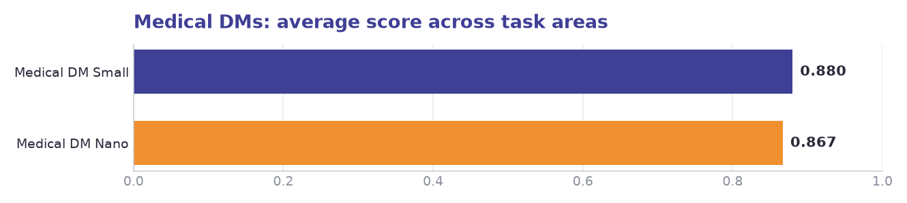

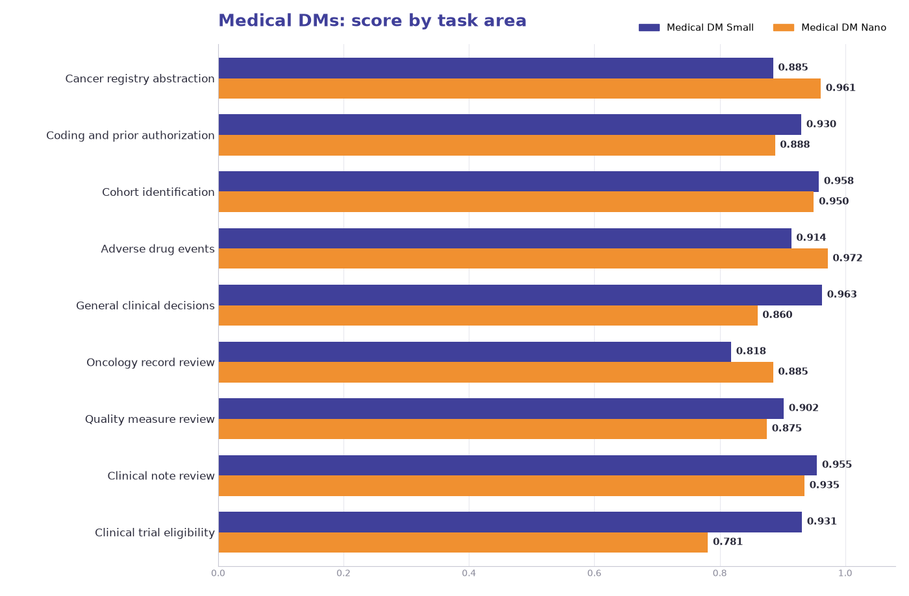

Score on nine task areas: the mean of accuracy and macro precision, recall and F1. Bold is the best score in the row.

{:.table-model-big}
| Task area | Medical DM Nano | Medical DM Small |
|:---|---:|---:|
| Cancer registry abstraction | **0.961** | 0.885 |
| Coding and prior authorization | 0.888 | **0.930** |
| Cohort identification | 0.950 | **0.958** |
| Adverse drug events | **0.972** | 0.914 |
| General clinical decisions | 0.860 | **0.963** |
| Oncology record review | **0.885** | 0.818 |
| Quality measure review | 0.875 | **0.902** |
| Clinical note review | 0.935 | **0.955** |
| Clinical trial eligibility | 0.781 | **0.931** |
| **Average** | 0.901 | **0.917** |

**Medical DM Small is ahead on six of nine task areas, with its largest margin on clinical trial eligibility (0.931 against 0.781). Medical DM Nano is ahead on cancer registry abstraction, adverse drug events and oncology record review.**

### PHI Guard Models and Modes

The PHI Guard family has seven models. Each answers one or more questions about a note: does a de-identified note still leak PHI, does a raw note hold any PHI, how much PHI does a note expose, and is a leak harmful.

{:.table-model-big}
| Model | Outputs | Use on | What it does | Example |
|:---|:---|:---|:---|:---|
| PHI Guard v0.6 | 1: a score, the probability that PHI is still readable | De-identified text | Gate de-identified notes before they leave the pipeline. | "Pt Maria Delgado seen on [DATE]..." scores 0.99 (leak); "Pt [NAME] seen on [DATE]..." scores 0.02 |
| PHI Guard v0.6 Fast | 1: a score | De-identified text | The same gate when speed matters more than precision. It flags many more clean notes. |  |
| PHI Guard Masked v0.6 | 1: a score | De-identified text | The v0.6 gate with a final fine-tuning step. It scores almost the same as PHI Guard v0.6. |  |
| PHI Guard Raw v0.6 | 1: a score, the probability that a raw note holds any PHI | Raw text | Skip or route PHI-free notes before de-identification. | "Shortness of breath, lungs clear, continue inhaler." scores 0.01; "John Miller, 64, seen 2024-02-11..." scores 0.99 |
| PHI Guard Richness v0.6 | 6: the probability that the level is at least 1, 2, up to 6; the level is how many reach 0.5 | Raw or de-identified text | How much PHI a note exposes, from level 0 (none) to level 6 (saturated). | A discharge note with a name, date of birth, MRN and phone number gets level 5 |
| PHI Guard v0.7 | 9: leak, harmful, richness (at least 1 to 6) and raw | Both, depending on the output | One call for everything. | "Patient [NAME], DOB 03/14/1956, MRN 4471923..." gets leak 0.99, harmful 0.99, level 3, raw 0.10 |
| PHI Guard v0.7 Fast | The same 9 outputs | Both, depending on the output | The same outputs, about 5x faster and a little less exact. |  |

PHI Guard v0.7 folds the leak, raw and richness models and a new harmful output into one model, with no loss of accuracy on any of them.

### PHI Leak Detection

Does a de-identified note still leak PHI? PR-AUC with a leak as the positive class. Public sets are the mean of four public datasets. The last column counts clean notes wrongly flagged at the 0.5 cut-off on the main set; fewer is better. Bold is the best in each column.

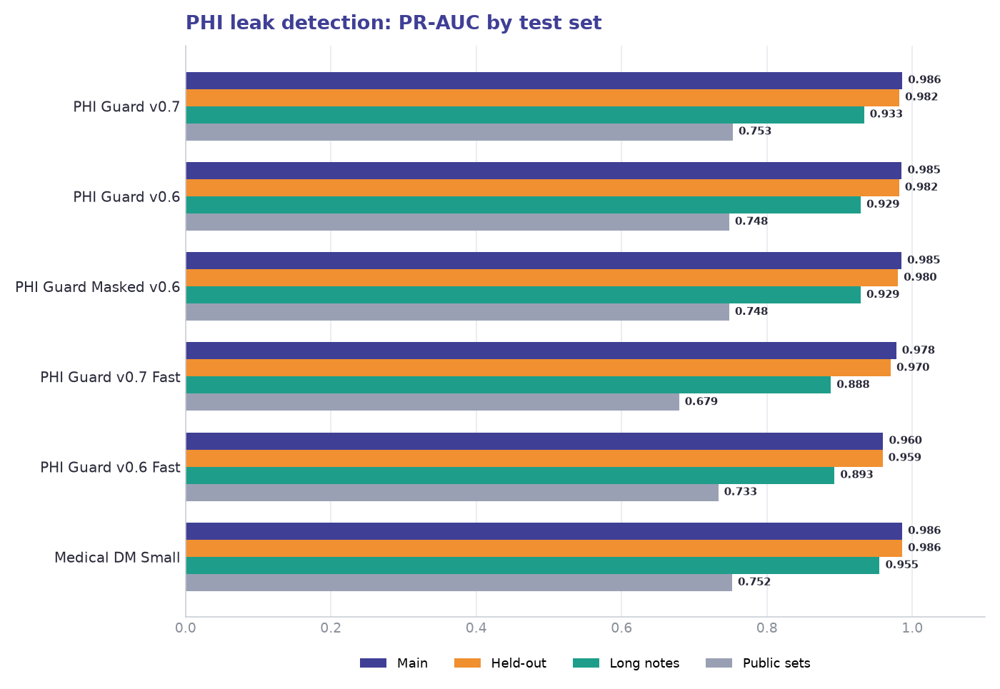

{:.table-model-big}
| Model | Main | Held-out | Long notes | Public sets | Clean notes flagged, main |
|:---|---:|---:|---:|---:|---:|
| PHI Guard v0.7 | **0.986** | 0.982 | 0.933 | **0.753** | 91 |
| PHI Guard v0.6 | 0.985 | 0.982 | 0.929 | 0.748 | 91 |
| PHI Guard Masked v0.6 | 0.985 | 0.980 | 0.929 | 0.748 | 96 |
| PHI Guard v0.7 Fast | 0.978 | 0.970 | 0.888 | 0.679 | 113 |
| PHI Guard v0.6 Fast | 0.960 | 0.959 | 0.893 | 0.733 | 384 |
| Medical DM Small | 0.986 | **0.986** | **0.955** | 0.752 | **39** |

**PHI Guard v0.7 matches or slightly beats PHI Guard v0.6 on every set. PHI Guard v0.7 Fast has far fewer false alarms than PHI Guard v0.6 Fast on the main set (113 against 384), but it is weaker on the public sets (0.679 against 0.733).**

#### Harmful leaks

Harmful PR-AUC, and the share of harmless-only leaks wrongly flagged at 0.5 on the main set; lower is better. The v0.6 models have no harm output, so the v0.6 leak score stands in.

{:.table-model-big}
| Model | Main | Held-out | Long notes | Harmless-only leaks flagged, main |
|:---|---:|---:|---:|---:|
| PHI Guard v0.6 (leak score) | 0.962 | 0.779 | 0.904 | 70% |
| PHI Guard v0.7 | **0.980** | 0.883 | 0.928 | 38% |
| PHI Guard v0.7 Fast | 0.977 | **0.885** | **0.936** | **21%** |

#### Raw notes

Does a raw note contain any PHI? PR-AUC on the test split and on held-out notes, and the notes wrongly flagged or missed at 0.5 on the test split.

{:.table-model-big}
| Model | Test PR-AUC | False positives | False negatives | Held-out PR-AUC |
|:---|---:|---:|---:|---:|
| PHI Guard Raw v0.6 | **0.9993** | 29 | **38** | 0.9984 |
| PHI Guard v0.7 | 0.9992 | **28** | 42 | **0.9986** |
| PHI Guard v0.7 Fast | **0.9993** | 47 | 42 | 0.9973 |

#### Richness

How much PHI a note exposes. Level error (MAE, lower is better) and rank correlation (rho, higher is better) on masked notes; the last two columns are held-out raw notes.

{:.table-model-big}
| Model | Main MAE | Main rho | Held-out MAE | Held-out rho | Long MAE | Long rho | Raw MAE | Raw rho |
|:---|---:|---:|---:|---:|---:|---:|---:|---:|
| PHI Guard Richness v0.6 | **0.137** | 0.859 | 0.325 | 0.902 | 0.245 | **0.773** | 0.265 | 0.954 |
| PHI Guard v0.7 | 0.140 | **0.866** | **0.303** | **0.909** | **0.238** | 0.755 | **0.238** | **0.956** |
| PHI Guard v0.7 Fast | 0.162 | 0.850 | 0.372 | 0.894 | 0.271 | 0.715 | 0.301 | 0.949 |

#### Speed per note

CPU models: one thread, a 1 KB note. GPU model: batched on a 24 GB GPU.

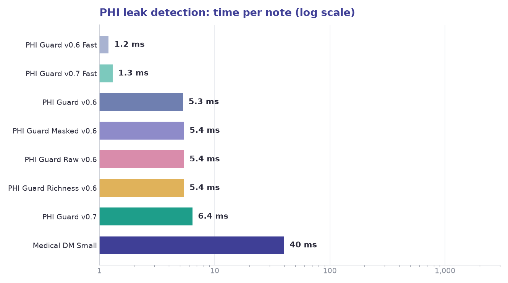

{:.table-model-big}
| Model | Runs on | Per note (ms) | One million notes |
|:---|:---|---:|---:|
| PHI Guard v0.6 | CPU, one thread (ONNX) | 5.3 | 1.5 h |
| PHI Guard v0.6 Fast | CPU, one thread (ONNX) | 1.2 | 20 min |
| PHI Guard Masked v0.6 | CPU, one thread (ONNX) | 5.4 | 1.5 h |
| PHI Guard Raw v0.6 | CPU, one thread (ONNX) | 5.4 | 1.5 h |
| PHI Guard Richness v0.6 | CPU, one thread (ONNX) | 5.4 | 1.5 h |
| PHI Guard v0.7 | CPU, one thread (ONNX) | 6.4 | 1.8 h |
| PHI Guard v0.7 Fast | CPU, one thread (ONNX) | 1.3 | 21.7 min |
| Medical DM Small | GPU (24 GB) | 40 | ~10-12 h |

## Partner With Us

We're committed to helping you stay at the cutting edge of medical AI. Whether you're building decision support tools, clinical chatbots, or research platforms — our team is here to help.

**[Book a call with our experts to:](https://www.johnsnowlabs.com/schedule-a-demo/)**

- Discuss your specific use case
- Get a live demo of the Medical LLMs
- Explore tailored deployment options.

