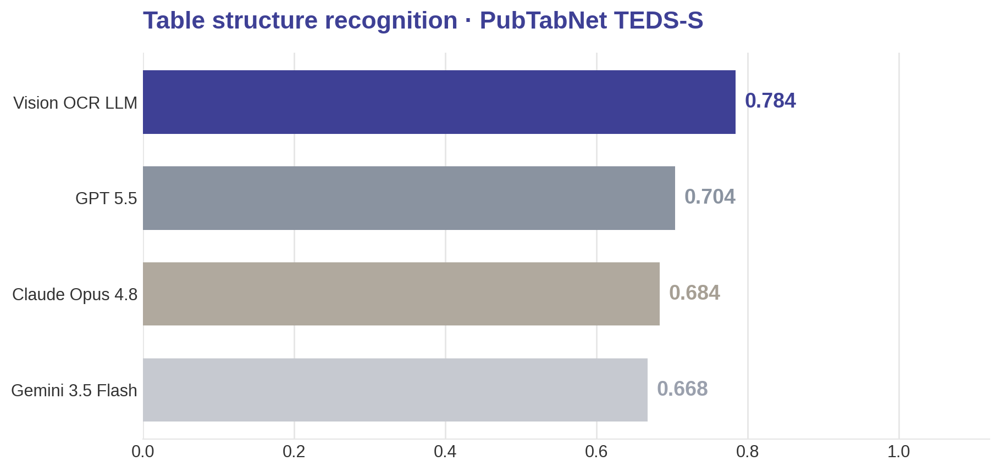
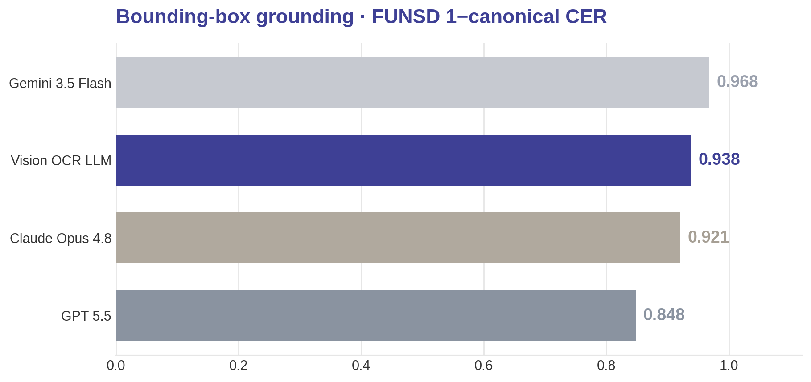
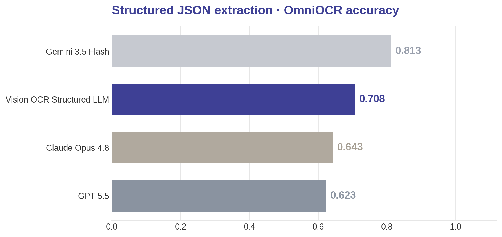
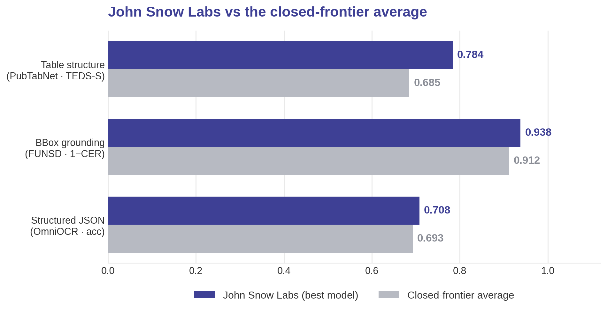

Industry Benchmarks and Academic Research strongly agree that Task-optimized OCR models beat general-purpose frontier systems on crucial tasks for document pipelines: grounding every token to a precise bounding box, and turning a page into schema-valid structured output.
At John Snow Labs, we've built a focused pair of OCR models for exactly those tasks.

**Vision OCR LLM** and **Vision OCR Structured LLM** are benchmarked head-to-head against the leading closed frontier systems (GPT 5.5, Claude Opus 4.8, and Gemini 3.5 Flash) across table structure, bounding-box grounding, and structured JSON. Closed frontier models should not run on patient records, ours can. 
Licensed for on-premise or private cloud deployment, keeps PII and PHI inside your infrastructure, HIPAA-friendly, without giving up accuracy where it matters most.

### Vision OCR Offering

| Model Name | Recommended GPU Memory | Max Sequence Length | Max KV-Cache | Tensor Parallel Sizes | Supported Platforms
|---|---|---|---|---|---|
| Vision-OCR-LLM | ~6 GB | 32K | 4 GB | 1, 2, 4 | [On-Premise](https://nlp.johnsnowlabs.com/docs/en/LLMs/on_prem_deploy)   [AWS](https://aws.amazon.com/marketplace/pp/prodview-d7un4r7xpiwje)   [Azure](https://marketplace.microsoft.com/en-us/product/virtual-machine/johnsnowlabsinc1646051154808.visual_language_ocr_llm?tab=Overview)   [Databricks](https://marketplace.databricks.com/details/c90c05de-8957-443d-8e1d-b73358d82b67/John-Snow-Labs_Vision-OCR-LLM)   [Snowflake](https://app.snowflake.com/marketplace/listing/GZTYZ4386LJXB/john-snow-labs-vision-ocr-llm) |
| Vision-OCR-Structured-LLM | ~32 GB | 128K | 17 GB | 1, 2, 4 | [On-Premise](https://nlp.johnsnowlabs.com/docs/en/LLMs/on_prem_deploy)   [AWS](https://aws.amazon.com/marketplace/pp/prodview-rrpnzcxjmhtfy)   [Azure](https://marketplace.microsoft.com/en-us/product/virtual-machine/johnsnowlabsinc1646051154808.visual_language_ocr_structured_llm?tab=Overview)   [Databricks](https://marketplace.databricks.com/details/e5063101-57bb-4523-baa0-48da9cf6d4ab/John-Snow-Labs_Vision-OCR-Structured)    [Snowflake](https://app.snowflake.com/marketplace/listing/GZTYZ4386LJXF/john-snow-labs-vision-ocr-structured-llm) |

*Note: bf16 serving, GB = 10⁹ bytes. Recommended GPU Memory covers measured model weights, KV cache at each model's max context (128K for Vision OCR Structured LLM, 32K for Vision OCR LLM), and ~8% activation/runtime overhead, per [DJL's LMI Deployment Guide](https://docs.djl.ai/master/docs/serving/serving/docs/lmi/deployment_guide/instance-type-selection.html). Typical OCR context (~8K) is far smaller — ~19 GB / ~3 GB, single-GPU.*

- **Vision OCR LLM**: *Grounding specialist.* Word-level OCR with precise bounding boxes, single-GPU. [AWS Marketplace](https://aws.amazon.com/marketplace/pp/prodview-d7un4r7xpiwje?sr=0-3&ref_=beagle&applicationId=AWSMPContessa)
- **Vision OCR Structured LLM**: *Structure specialist.* Document to schema-constrained JSON. [AWS Marketplace](https://aws.amazon.com/marketplace/pp/prodview-rrpnzcxjmhtfy?applicationId=AWSMPContessa&ref_=beagle&sr=0-1)

### Introduction

John Snow Labs' Vision OCR models hit competitive accuracy on the benchmarks that matter in production while staying small enough to deploy privately. **Vision OCR LLM** posts the top table-structure score of every model tested (0.784 TEDS-S) and top-tier grounding (0.938) on a single commodity GPU; **Vision OCR Structured LLM** handles schema-constrained JSON extraction (0.708) ahead of two of the three closed frontier systems. All models run inside your firewall, where the closed frontier cannot, ideal for hospitals and clinics where cost, speed, and privacy matter.

### Table Structure Recognition Performance

TEDS-S (structure-only tree-edit-distance similarity) scores table-structure recovery on a complexity-balanced 50-table slice of PubTabNet. Vision OCR LLM beats every closed frontier model.

{:.table-model-big}
| Model | TEDS-S |
|---|---|
| **Vision OCR LLM** | **0.784** |
| GPT 5.5 | 0.704 |
| Claude Opus 4.8 | 0.684 |
| Gemini 3.5 Flash | 0.668 |

> **Leads the frontier on table structure, privately.** Vision OCR LLM posts the highest TEDS-S of every model tested (0.784), 8 points ahead of the best frontier system, running single-GPU inside your firewall.

*Dataset: PubTabNet validation set. 50 tables selected by structural complexity — every table scored (spanning cells, row and cell counts), split into 5 complexity quintiles, 10 sampled evenly from each — so the slice spans simple to very dense rather than favoring either. All four models on the identical 50.*

### Bounding-Box Grounding OCR Performance

Grounding is scored on FUNSD as 1 minus canonical CER (the reading-order, region-matched metric behind our published AWS Marketplace figure).
Predicted boxes are first IoU-matched to gold regions (0.78 overlap threshold), then CER measures how accurately it read the text inside those matched regions. Vision OCR LLM lands in the top tier, ahead of GPT 5.5 and Claude Opus 4.8, and is the only model here that pairs a top-tier score with full-page coverage.

{:.table-model-big}
| Model | 1 − canonical CER |
|---|---|
| **Vision OCR LLM** | 0.938 |
| GPT 5.5 | 0.848 |
| Claude Opus 4.8 | 0.921 |
| Gemini 3.5 Flash | **0.968** |

> **Top-tier grounding, full-page coverage.** Vision OCR LLM scores 0.938, ahead of GPT 5.5 and Claude Opus 4.8. Canonical CER rewards only tightly localized regions, so a high frontier score can mean partial page coverage; Vision OCR LLM combines its score with full-page coverage.

*Dataset: FUNSD official 2019 test split — all 50 test forms (the complete test set, not a sub-sample), with word-level box + text ground truth. All four models on the identical 50.*

### Structured JSON Extraction

OmniOCR scores schema-constrained document-to-JSON as field accuracy, the task production extraction pipelines are built on. Vision OCR Structured LLM is competitive with the frontier, ahead of GPT 5.5 and Claude Opus 4.8, and matches its published AWS Marketplace figure (0.714).

{:.table-model-big}
| Model | JSON accuracy |
|---|---|
| **Vision OCR Structured LLM** | 0.708 |
| GPT 5.5 | 0.623 |
| Claude Opus 4.8 | 0.643 |
| Gemini 3.5 Flash | **0.813** |

> **Frontier-competitive structured extraction, private by design.** Vision OCR Structured LLM reaches 0.708 JSON accuracy, ahead of GPT 5.5 and Claude Opus 4.8, while licensed for deployment inside your firewall.

*Dataset: OmniOCR (`getomni-ai/ocr-benchmark`, pinned revision), test split — the first 100 documents. All four models on the identical 100.*

### How the Models Compare

Across all three task families, a John Snow Labs model beats the closed-frontier average, each model shown on its target task.

Vision OCR LLM leads on table structure (0.784) and top-tier grounding (0.938, with full-page coverage); Vision OCR Structured LLM stays ahead of two of three frontier systems on structured JSON. The whole family runs single-GPU on-premise, which the closed frontier cannot.

*All numbers measured on our own harness under identical conditions (same prompt, 0 errored docs). BBox is shown as 1 − canonical CER (higher is better) — the reading-order, region-matched metric behind our published AWS Marketplace figures (raw canonical CER 0.039 for Vision OCR LLM on FUNSD; 0.714 JSON accuracy for Vision OCR Structured LLM on OmniOCR).*

